# Class Manager: system architecture and design

Written 15 November 2026 from `main` at commit 9917cf2 ("CM: SQLite storage, student table, phone outbox and optional mailbox", PR #96), which follows PR #95. `desktop/package.json` reads 0.21.3; `STRUCTURE.md` labels the last changes 0.21.4. The number should be settled at the next release. The test suite on this commit has 318 tests and all pass. Every statement below was checked against the source; statements of judgement are confined to Section 15 and are labelled as such. This document replaces the version of 10 November (0.7.0).

## Contents

1. Purpose and product direction
2. System context
3. Components and deployment modes
4. The desktop CM
5. Data model and storage
6. Server interface (API)
7. Main flows
8. Analytics: definitions, thresholds and evidence
9. Privacy and security
10. User interface design
11. Configuration
12. Build and release
13. Testing
14. Repository layout
15. Not done yet, known limits and risks

---

## 1. Purpose and product direction

Class Manager (CM) gives a lecturer insight into class dynamics and supports student-centred teaching on that evidence. The question it answers is which topics the class has learned, which misconceptions persist, which students need attention, and whether discussion between students improved understanding. Attendance, live quizzes, practice and group work are the means of collecting that evidence; they are secondary to the insight. PHYS 143 is one course among many that CM can run, and ships as a course pack source in `class-manager/course-packs/phys143/`, not as part of CM.

Design commitments that run through every section:

- **The lecturer's computer is the system of record.** Records are kept in one encrypted database per course on that computer. Every external service (Google, Cloudflare, an LMS, an AI assistant, a cloud folder) is optional and off until the lecturer switches it on.
- **The student ID is the unique key.** One ID is one student, in every table, import and phone request (Section 5.4).
- **Evidence is labelled.** A figure built on few students or few sessions says so, and an association is never presented as a cause (Section 8).
- **Maintainable by one person.** One responsibility per file, a short README per module folder, tests beside the code, and `STRUCTURE.md` and this document updated with each change (Section 14).
- **Wording.** In text and on screens CM is called "CM", never "the app".

## 2. System context

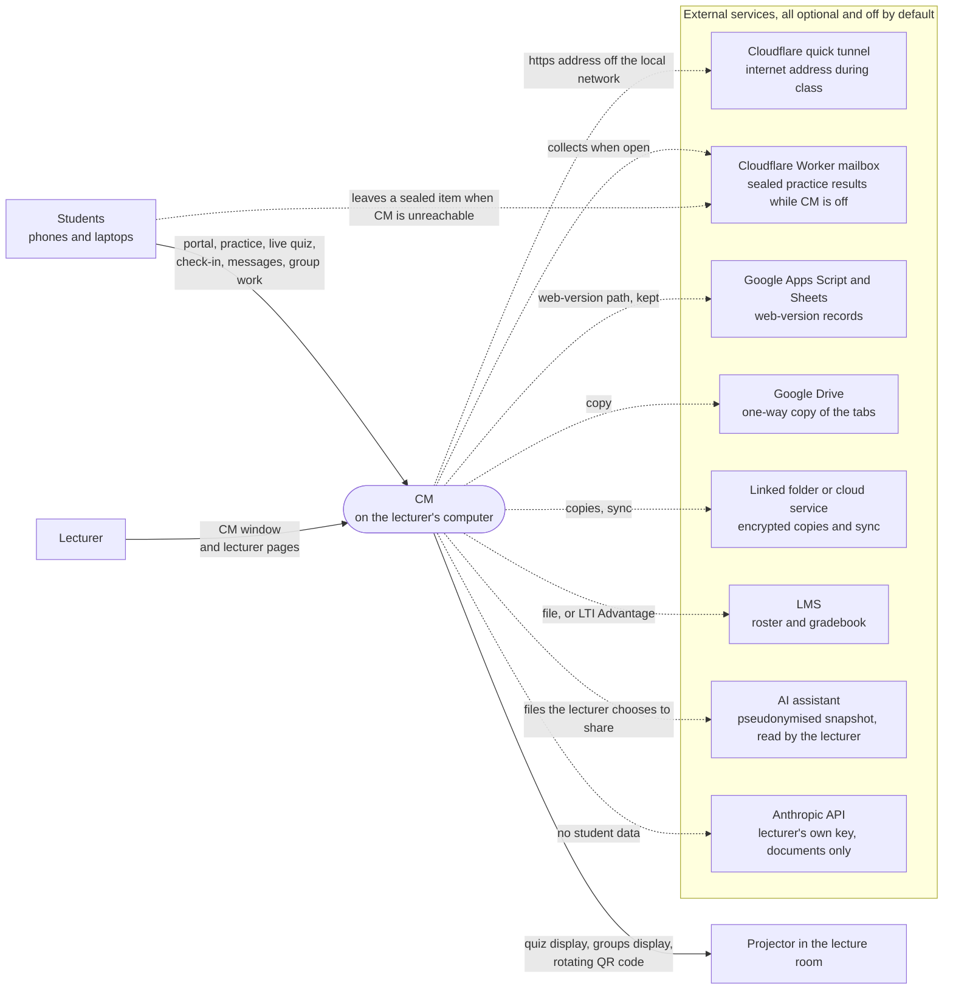

Students never need an account. The lecturer needs no account in the default mode. Installers reach lecturers on request (Section 12).

## 3. Components and deployment modes

The system has three layers, and the same server script serves all of them.

1. **Pages.** Static HTML and plain JavaScript in `class-manager/`, with no framework and no build step. The phone pages share `assets/` (student pages, practice engine, `outbox.js`, `relay-seal.js`, `tracking.js`).
2. **Server script.** `apps_script/quiz_receiver.gs` (3,757 lines, `SCRIPT_VERSION` `2026-11-15-signin-3`) holds every rule: scoring, attendance, access, statistics, groups, assignments, calendar, messages. It is built from eleven modules in `apps_script/src/` by `apps_script/build.js` (core, auth, password, assessment, attendance, analytics, records, collaboration, communication, portal, router), so Google Apps Script still receives one file. It answers `doGet` (reads) and `doPost` (submissions and every request that carries a credential).
3. **Records.** One encrypted SQLite database per course on the lecturer's computer, or, in the web version, a Google Sheet.

| Mode | Pages served from | Server script runs in | Records kept in | Reach |
|---|---|---|---|---|
| A. Web (kept) | Any static host (GitHub Pages) | Google Apps Script bound to a Google Sheet | The Google Sheet | Anywhere with internet |
| B. Desktop, local (default) | CM's HTTP server, port 8143 | Node `vm` inside the Electron main process (`desktop/backend.js`) | `course.db` in the course's data folder | The local network while CM is open; anywhere through the optional tunnel; phones can leave practice results in the optional mailbox when CM is off |
| C. Desktop with an Apps Script address | CM's HTTP server | Google Apps Script | The Google Sheet | Pages on the local network; records online |

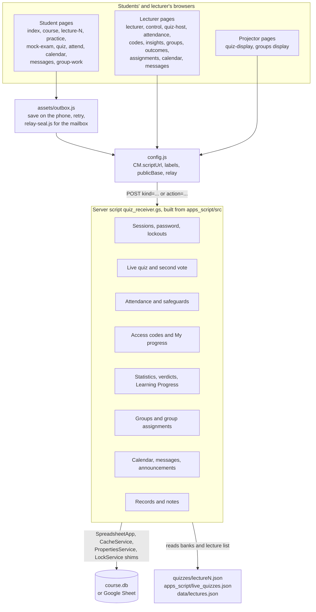

In mode A the script reads the banks over HTTP from `SITE`. In modes B and C the desktop server answers those paths itself, merging the course banks with the lecturer's approved questions. The web path (mode A) is deliberately kept; removing it is not planned.

## 4. The desktop CM

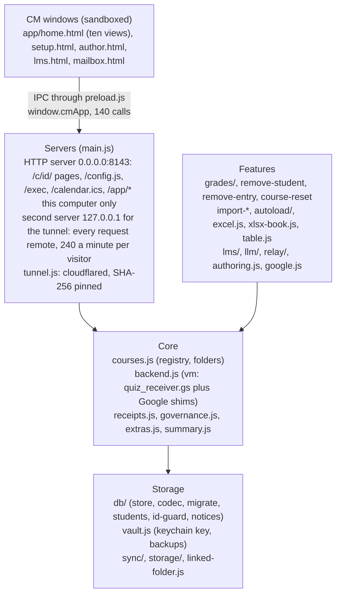

**Screens.** The CM window has ten views in four groups (Section 10): Class Analytics; Class Tools, Attendance, Quizzes and Questions; Students, Learning Progress, Class Roster; Course and Content, Grades and Results; and CM Settings. Further screens open from these: the LMS connector and the Mailbox from Course and Content, the Overview analytics cards, and the resource and question authoring window.

**IPC surface.** `preload.js` exposes a fixed list of 140 calls prefixed `cm:` as `window.cmApp`; the main process answers only those names. The LMS, LLM and mailbox calls are registered by `desktop/lms/ipc.js`, `desktop/llm/ipc.js` and `main.js`. The renderer is sandboxed (`contextIsolation`, no `nodeIntegration`).

**Internet access.** `tunnel.js` downloads `cloudflared` once from Cloudflare's GitHub releases, checks its SHA-256 against a fixed value, and starts a quick tunnel to the second server. While it is on, `config.js` carries `publicBase`, so QR codes and links use the `https://*.trycloudflare.com` address. The address stops by itself after the time set in CM Settings (3 hours by default). Lecturer requests through it are refused unless CM Settings allows them. A phone hotspot is the documented alternative when campus Wi-Fi isolates devices.

**Many courses.** One installation runs all the lecturer's courses (built in 0.8.0). `courses.js` keeps the registry; the server serves each course under `/c/<id>/`, and addresses without the prefix serve the default course so earlier QR codes keep working. Each window belongs to the course in its address, and its buttons act on that course only. Nothing is shared between courses: a student in two courses has two records, two access codes and two phone registrations. A course's content (lectures, files, banks) may live in a folder the lecturer chooses, such as a local clone of a repository; student records never go into that folder.

---

## 5. Data model and storage

### 5.1 Records of a course

A course's records are held as named tabs (rows and columns, as in a spreadsheet) because the server script was written for a spreadsheet. In CM each tab is stored in the course database (Section 5.3); in the web version the same tabs are the tabs of the Google Sheet. The student ID is the key that joins the tabs. Tabs are created by `setup` (web) or on first use.

| Area | Tab | One row per | Key fields |
|---|---|---|---|
| Settings | Key | Join code | Join code, correct letters, ranking; J2 host key (`sha256:salt:hex` once changed); K2 Totals rule (Best or Latest); L2 Master on or off; live quiz week |
| Class list | Roster | Student | Student ID, name |
| Live quiz | Quiz_Control | Lecturer-run quiz | join_code, status (Draft, Ready, Lobby, Running, Paused, Ended, Released), timers, mode, round, review_q, n_questions, question_ids, week, **vote** (1 or 2), **discussed** (questions that had a second vote) |
| | Presence | Join | ID, first name, code, joined, submitted |
| | Answers | Answer | ID, code, question, letter, round, confidence |
| | Staged_Quiz | Student per quiz | Marked results held until release |
| | Form Responses 1 | Released attempt | Timestamp, first name, ID, join code, Q1 to Q5, score, round, questions, answers, week |
| | Item_Log | Student per live question | Timestamp, join code, round, week, ID, Q, question ID, answer, correct answer, correct, confidence, **first answer**, **discussed** |
| | Explanations | Question | Optional explanation overrides |
| Marks | Master, Scores, Totals | Student | One column per quiz; rebuilt on release |
| Practice | Attempts | Practice or mock attempt | Timestamp, ID, quiz, attempt, score, total, seconds, wrong question IDs, question IDs asked |
| | Reports | Reported problem | Lecture, question ID, question, answer shown, comment, page |
| Attendance | Attendance_Control | Session | Code, label, status, opened, closed, link secret, classroom location |
| | Attendance_Log | Accepted check-in | Timestamp, session, ID, on roster, salted device hash, location result (distance only) |
| | Attendance | Student | One column per submitted session: 1 or 0 |
| | Attendance_Flags | Flag | Session, ID, device hash, reason (wrong code, device reuse, location, or "waiting for approval: ...") |
| | Attendance_Phones | Student | Student ID, salted device hash, registered |
| | Not_On_List | Unknown ID | IDs that checked in but are not on the roster |
| Learning | Access_Codes | Student | Student ID, personal code `XXXX-XXXX` (no 0, O, 1, I or L), issued |
| | Question_Stats | Question | Proportion correct, discrimination, label |
| | Question_Outcomes | Question | Question ID, lecture, outcome number, set |
| Groups | Groups | Student per set | Set, group, ID, name, group mark, out of, locked, created |
| | Assignments | Assignment | ID, set, groups (`all` or a list), title, brief, due, outcome, out of, status |
| | Group_Work | Submission event | Time, assignment ID, set, group, ID, kind (`work`, `part`, `peer`), text, link, rating |
| | Assignment_Marks | Group per assignment | Assignment ID, group, mark, feedback, marked |
| Communication | Calendar | Event | Event ID, title, kind, start, end (local text), all day, location, agenda, resources, week, linked session, visibility, series |
| | Messages | Message | Message ID, time, conversation, from, name, text, status, removed by |
| | Chat_Groups, Chat_Read | Group; reader per conversation | Members and owner; last read time |
| | Announcements | Announcement | Title, text, audience, pinned, show from, link, event ID, status |
| Audit | Log | Event | Every submission outcome and lecturer action |

**Script properties.** `draw_salt` (a random value per workbook mixed into the question draw) and the chat settings (`chat_mode`, `chat_dm`, `chat_groups`, `chat_rules`, `chat_muted`).

**Conversation IDs.** `CLASS`; `L:<set>|<group>` (a lecturer-made group); `S:<id>` (a student-made group); `DM:<studentId>`; `P:<idA>:<idB>`.

**Tabs added since 0.7.0.**

| Area | Tab | One row per | Key fields |
|---|---|---|---|
| Records | Records | Score | Timestamp, Student ID, category, assessment, score, out of, lecture (laboratory, assignment, practice and group assessments) |
| | Student_Notes | Note | Timestamp, Student ID, note, by (lecturer only) |
| Analytics | Interventions | Support given | ID, kind, date, quizzes held, student IDs, note (`extras.js`); groups are Roster column 3 |
| Governance | Audit_Log | Sensitive action | When, who, action, student ID, detail; no marks or answers (`governance.js`) |
| | Term_Status | Term | Open or closed; a closed term refuses student writes |
| Set aside | Removed_Students | Removed student | When, ID, name, the student's class rows kept as text, restorable |
| | Removed_Entries | Removed row | When, batch, tab, position, the row as text, restorable |

Besides tabs, the database holds script properties (`draw_salt`, chat settings, `join_base`, the session secret, the password hash and recovery hash), the student table, ID notices and retry receipts (Section 5.3).

**Conversation IDs.** `CLASS`; `L:<set>|<group>` (a lecturer-made group); `S:<id>` (a student-made group); `DM:<studentId>`; `P:<idA>:<idB>`.

### 5.2 How the records relate

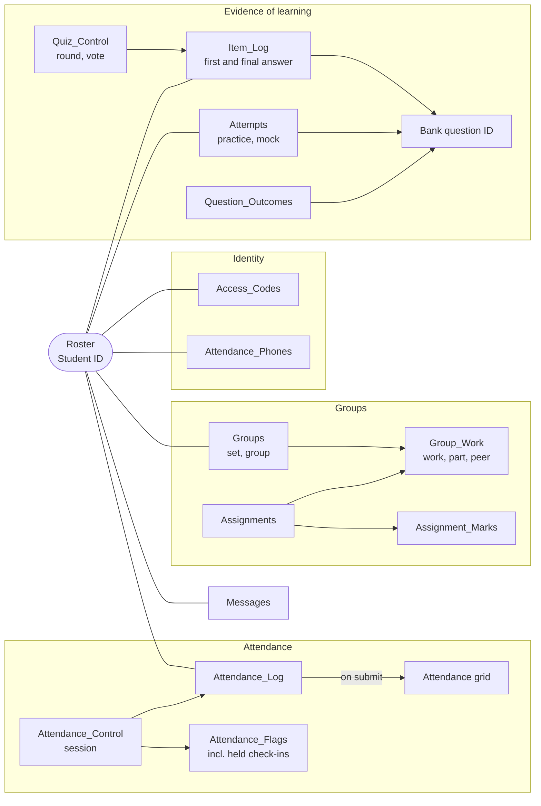

### 5.3 Storage on the lecturer's computer (modes B and C)

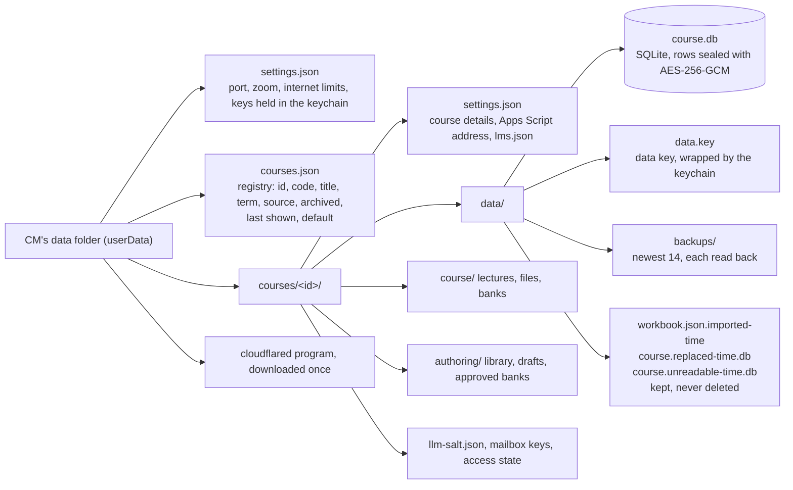

**The database** (`desktop/db/`, one `course.db` per course, using the SQLite built into Node and Electron 44). Tables: `meta`, `sheet` (a tab's name and position), `cell_row` (one sealed row of a tab), `student` (Section 5.4), `id_notice` (a merge of two rows of one ID, both sources kept), `receipt` (the answer given to a keyed request, so a repeat runs once) and `prop` (script properties).

- Every row is sealed with the vault key (AES-256-GCM, `codec.js`), so student records are not readable in the file.
- Only changed rows are written, in one transaction per save (`BEGIN IMMEDIATE`, journal mode WAL, synchronous FULL).
- An older `data/workbook.json`, or a restored backup, is treated as an inbox: it is imported into a new database file, read back and compared cell by cell with the source, and only then put in place. The original is renamed and kept. A replaced database is renamed `course.replaced-<time>.db`; an unreadable one `course.unreadable-<time>.db`. Nothing is deleted (`migrate.js`).
- The key is held by the system keychain where the computer has one (CM Settings says whether it does). Copying the data folder to another computer does not copy the keychain, so the copy cannot be read there.
- Backups: when a course opens, every four hours, and when CM closes; each is read back at once; the newest 14 are kept (`vault.js`). "Save a backup to a file" makes one file encrypted with a passphrase (scrypt) for another computer; a lost passphrase cannot be recovered.
- Downgrade: CM must not be downgraded after 0.8.x or after this storage change, because the data layout is new.

**Reset and removal.** `course-reset.js` moves the chosen parts of a course into a `reset-<time>` folder and can move them back ("setup" keeps the class list, scores and attendance; "all" empties the course so it looks new, including backups, mailbox keys, receipts and the audit log; the lecturer types a confirmation and a backup is taken first). `remove-student.js` and `remove-entry.js` set records aside (Removed_Students, Removed_Entries) and restore them; nothing is deleted.

### 5.4 One student, one ID

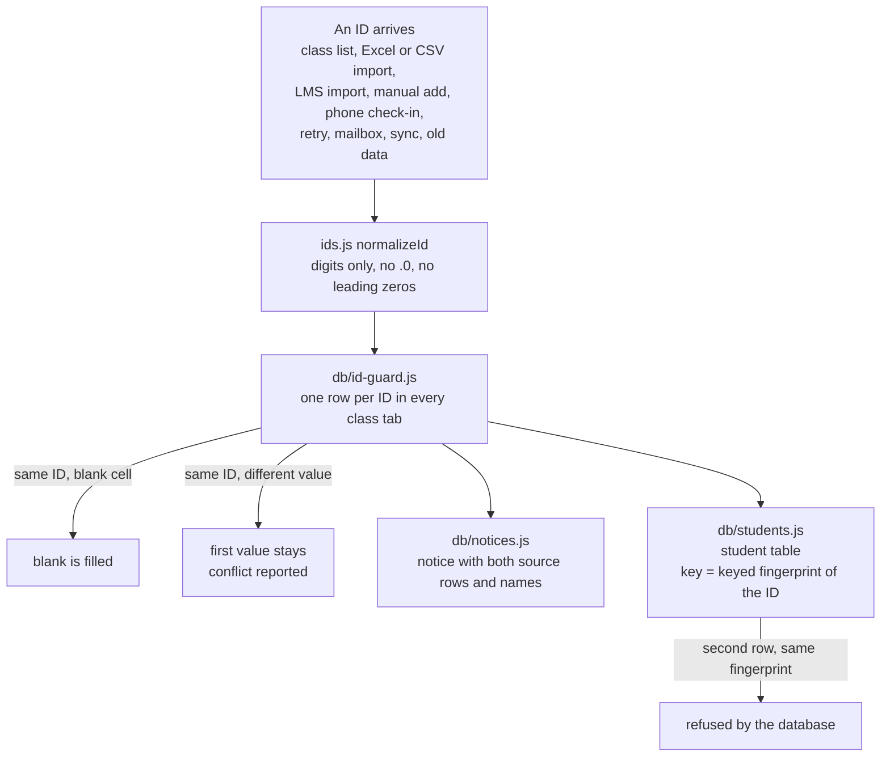

"022583439", " 22583439 ", "22583439.0" and 22583439 are one ID (`desktop/ids.js`, kept in step with `normId_` in `apps_script/src/00-core.gs`). `db/id-guard.js` merges rows of one ID in the class list, attendance, master, scores, totals and access codes without overwriting a different value; log tabs keep every line but write the ID in one form. The student table holds a unique key on a keyed fingerprint (`vault.fingerprint`, an HMAC of the ID with the data key), so the database itself refuses a second row for an ID while the IDs stay unreadable in the file. An ID repeated in the class list is kept once and reported. Old data is checked when a course opens. Each merge leaves a notice; `backend.idNotices()` lists them and `backend.resolveIdNotice(tab, id, name)` records the lecturer's choice of name. There is no screen for the notices yet (Section 15).

### 5.5 Storage in students' browsers

`localStorage`: practice progress, the remembered student ID and access code (optional), the device token used for attendance, and the phone outbox (Section 7.5). `sessionStorage`: the signed-in session on lecturer pages. The service worker (`sw.js`) caches the portal shell; a phone that cached `assets/` before an upgrade may need one refresh to receive the outbox.

---

## 6. Server interface (API)

Every page request is sent by `POST` (`action=...` for reads and lecturer actions, `kind=...` for submissions), so that keys and codes never appear in a web address. A `GET` still works for public data only; a `GET` that carries a key or code is refused. In CM both arrive at `/exec`.

**Sessions.** The host key (or the lecturer's own password, Section 9) or a student's access code is sent once. When it is right, the answer carries `_session`: an HMAC-SHA256 signature over role, subject, expiry and binding, with a secret in the script properties. A lecturer session lasts 8 hours, a student session 14 days. The binding is the stored host key or the student's current access code, so changing either ends every session made with the old one; "Sign everyone out" replaces the secret. Pages keep the session, not the key.

**Public or student actions.**

| Action | Purpose | Check |
|---|---|---|
| `status`, `questions`, `review`, `ranking`, `result`, `display` | Live quiz state (cached 3 s), questions without answers (cached 120 s), review with before and after spreads, first-name ranking, own result, projector | Join code; Student ID where relevant |
| `portal_status` | What is open now | None |
| `my_results` | A student's attendance, quizzes, practice, progress by lecture and by outcome, revisit list, groups | Student ID and access code; 6 failures lock the ID for 10 minutes |
| `attend` | Check in | QR token, access code, device token, phone binding, location (mode A) |
| `group_work` | The student's group assignments; submit work, own part, peer ratings | Student ID and access code |
| `calendar`, `calendar_ics` | Student-visible events; iCalendar file or feed | None (host key adds lecturer-only events) |
| `announcements`, `chat` | Announcements; conversations and messages | None, or ID and access code, or host key |
| `hostcheck`, `version` | Key check; script version | None |

**Lecturer actions (host key).**

| Area | Actions |
|---|---|
| Live quiz | `control` (open, start, pause, next, **revote**, end, release, reset), `host`, `held_status`, `held_release_quiz`, `held_discard_quiz`, `set_week`, `preclass` |
| Attendance | `attend_open`, `attend_close`, `attend_status`, `attend_submit`, `attend_discard`, `attend_review`, `attend_approve`, `attend_remove`, `attend_phone_reset` |
| Class list | `roster_edit`, `roster_tidy`; POST `roster_sync` |
| Learning | `insights`, `class_stats`, `student_stats`, `learning_progress`, `access_codes`, `outcomes` |
| Groups | `groups` (make, move, lock, mark, delete, list), `groups_display`, `assignments` |
| Communication | `calendar_edit`, `announcements` with `op`, `chat` with `op` (moderation) |
| Key | `setkey` (12 to 40 characters, stored as salted SHA-256) |

**POST kinds.** `join`, `progress`, `answer` (with confidence), `attempt` (practice and mock, with question IDs), `report`, `roster_sync`.

**Added since 0.7.0.** `join_base` (host: read or set the base of the course's join codes; a join code is the base followed by the week number, base 2627 by default, so 26271 is Week 1), the password calls (choose, change, recover, `resetHostKey`), a records read (`studentRecords_`: records and notes by student ID), "Sign everyone out", and a keyed request (`ckey`) that is carried out once (`receipts.js`). CM's own screens use IPC rather than these calls for everything that does not need a phone.

**Concurrency.** Writes take `LockService.getScriptLock()` (a shim in CM). Check-ins use an atomic append and take no lock. Hot reads are cached in `CacheService` (quiz status 3 s, open attendance session 5 s, questions 120 s, chat version stamp).

---

## 7. Main flows

### 7.1 Attendance with anti-proxy safeguards

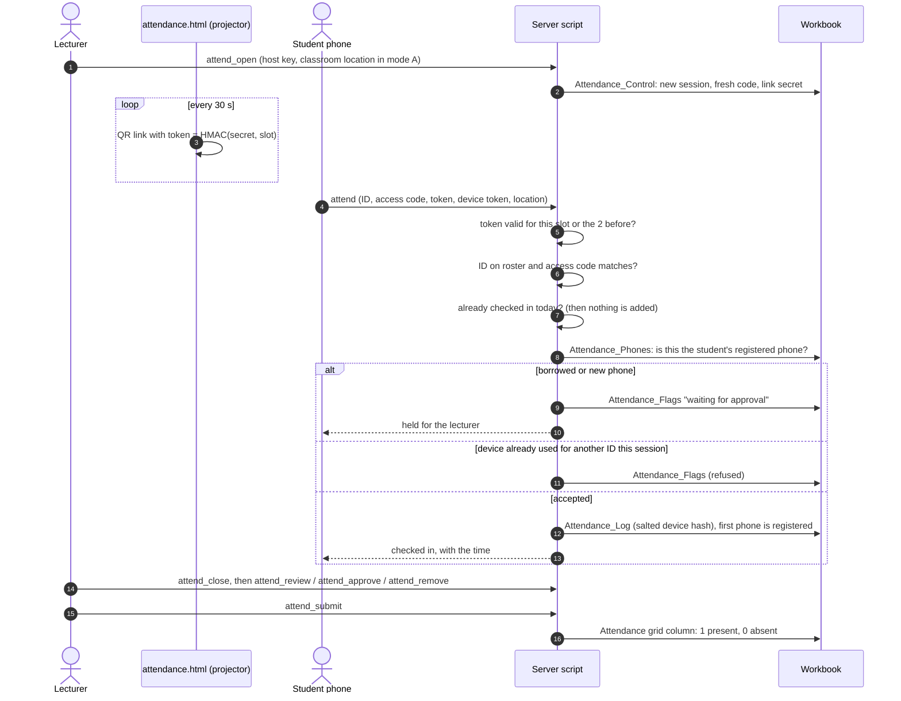

Safeguards, in order of application: the rotating QR token (30-second slots, two slots of grace), six failures per device or ID before a pause, the personal access code, one check-in per ID per day, one phone per student for the term (a borrowed or new phone is held, never counted on its own), one ID per device per session, and the location check (mode A only, 500 m radius, enforced; off in CM because phones give location only to https pages). Nothing reaches the Attendance grid until the lecturer submits.

### 7.2 Live quiz with ask, discuss, revise

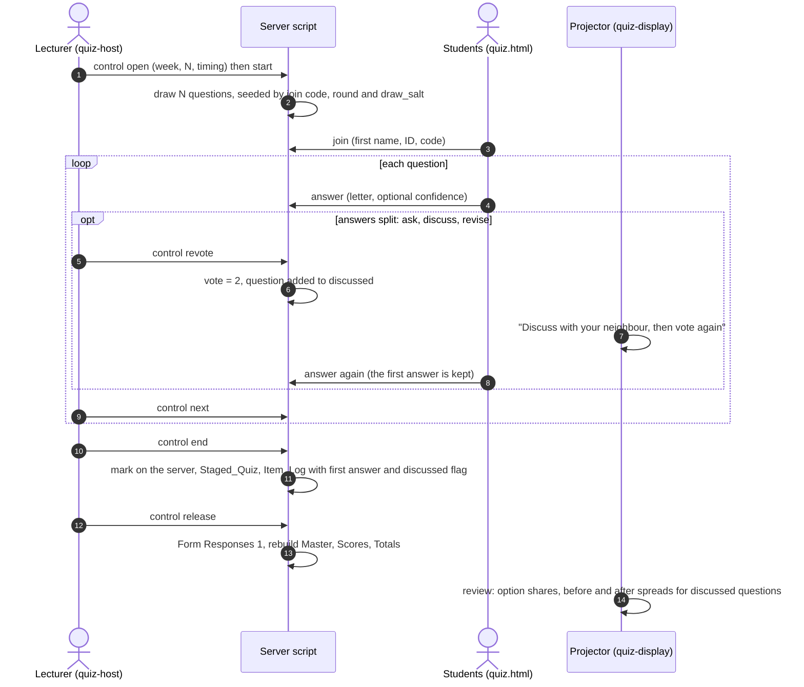

The score uses the final vote. Answer letters never reach the student page before review. The first submission per ID and join code in a round counts; 15 seconds of grace are allowed after a deadline.

### 7.3 Groups and group assignments

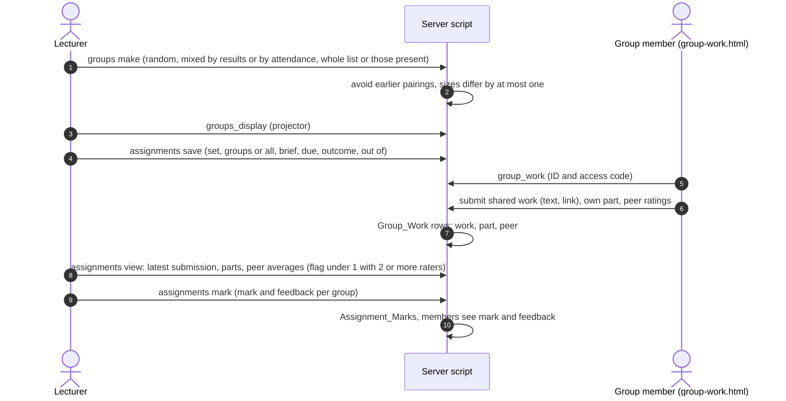

Peer ratings (Contributed fully, partly, little; scored 2, 1, 0) are shown to the lecturer only.

### 7.4 Practice, the mock examination and My progress

Practice and the mock examination run in the browser from `quizzes/lectureN.json`. If the student enters an ID, `tracking.js` hands each attempt (score, time, question IDs asked and missed) to the phone outbox (Section 7.5), which delivers it to Attempts. Attempts join Master and Scores at the next release, for IDs on the roster only. My progress (`my_results`) opens only with the ID and the access code and shows the student's own record, progress by lecture and by learning outcome, and the questions to revisit with the slide to look at.

### 7.5 Phone outbox, safe retries and the optional mailbox

Practice results and question reports must not be lost because CM, the Wi-Fi or the internet was away for a moment. Live check-in and live quiz answers do not use this path: they need the room's CM and an immediate answer.

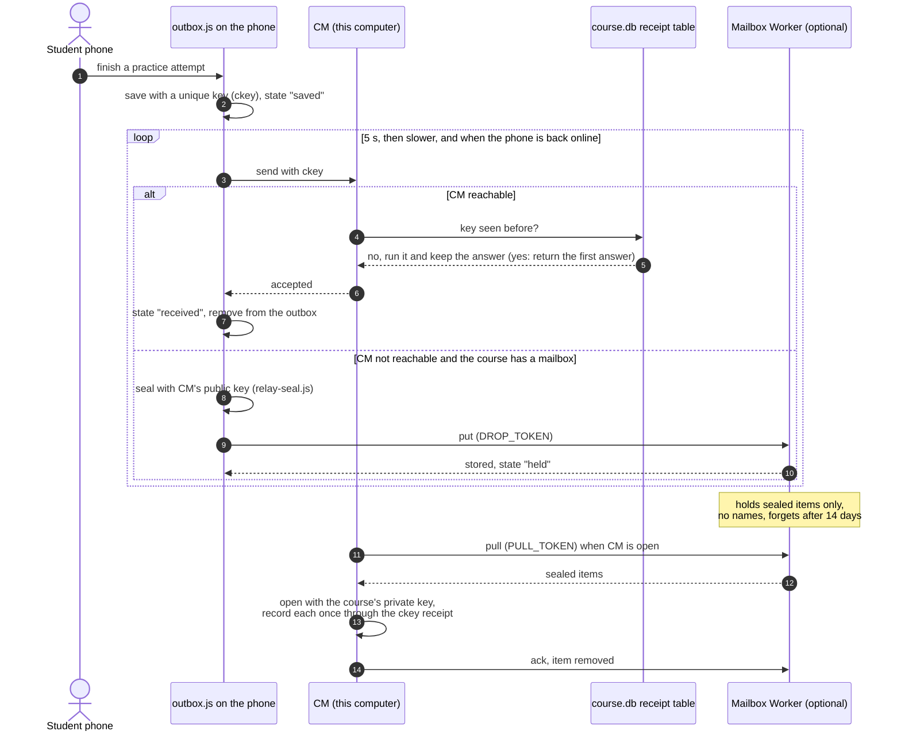

A request that carries a client key runs once: CM keeps the first answer and returns it to any repeat (`receipts.js`). The mailbox is a free Cloudflare Worker with one KV namespace (`relay/worker.mjs`, setup steps in `relay/README.md`). Phones encrypt with a fresh AES-256-GCM key wrapped with the course's RSA-2048 public key (OAEP, SHA-256); only CM holds the private key (`desktop/relay/crypto.js`). Limits: 16 KB per item, 1,000 waiting items per course, 14 days, and only practice results and question reports are accepted. Check-in and live quizzes never go through it. CM's Mailbox screen saves the address and the two codes, switches the mailbox on and off, and collects on demand.

### 7.6 Importing data, Excel and the grades table

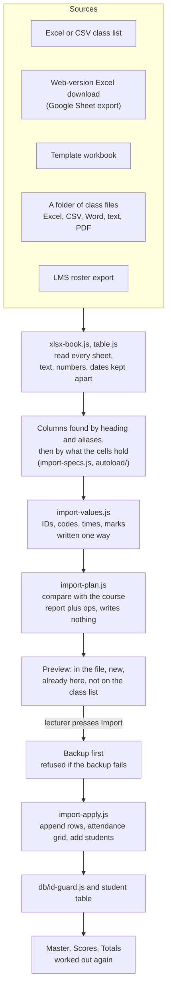

Nothing is written until the lecturer presses Import. Records already in CM are never changed; importing the same file twice adds nothing; a 1 in attendance is never turned into a 0. Students are matched by ID; IDs not on the class list are left out unless the lecturer ticks "Add the students in the file". Quiz questions found in a folder go to the review queue and are never approved automatically. Original files are only read. Excel download writes a Students sheet first, then every tab; names are written as First name and Last name columns for the LMS. Not imported: the web version's settings, host key, personal access codes, live session logs and sessions still open there.

**Grades and Results.** `desktop/grades/build.js` reads the records (Roster, Attendance, Attendance_Log, Form Responses 1, Attempts, Assignments, Groups, Assignment_Marks) and returns one row per student on the class list, with columns grouped as Attendance, Quizzes (one per week), Assignments and Practice. Each cell keeps the time of the entry it came from; each student has a last-activity time and a dated timeline. `view-model.js` writes times out, shows a blank as "no record" (never a zero), and makes the Excel sheets (Grades, then Timeline). On screen (`app/grades-view.js`, `row-select.js`, `row-actions.js`) a click selects a row (Ctrl or Cmd adds, Shift selects a range, Esc clears); an action bar offers Open timeline and Remove row. The choice between removing one entry and the whole student is explicit and confirmed, names what goes, sets records aside (Removed_Entries, Removed_Students) and offers Undo.

### 7.7 LMS roster and gradebook

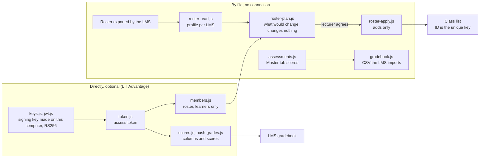

Everything is off until the lecturer switches it on (`lms.json`, https only). CM calls the LMS; the LMS never calls CM, so no public address is needed. CM sends the LMS only its own user id and points, never names. Rules kept (tests in `lms.test.js`): nobody is removed from CM; an existing name is never overwritten; a student with no score is left empty, never zero; a repeated ID is one student; a student not matched in the LMS is reported and not sent; with the connection off nothing is sent. Profiles exist for Canvas, Moodle, Blackboard, Brightspace and Sakai; another LMS that reads CSV needs one more entry in `profiles.js`. The direct connection has been tested against a mock LMS only.

### 7.8 Snapshot for an AI assistant

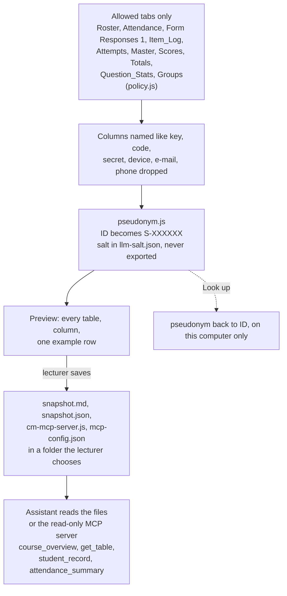

CM sends nothing itself; the lecturer decides what to share. Names are off by default; the lecturer may tick "Include student names" or "Keep real student IDs". The MCP server has no dependencies, needs Node 18 or later, and reads only `snapshot.json`. Not built: provider-neutral question generation (OpenAI, Gemini, local models) and an "ask about my class" panel inside CM; each would send data from CM itself and so needs its own preview and consent step.

### 7.9 Linked storage and course sync

Under CM Settings, "Link storage" keeps an encrypted copy of a course's records in a folder the lecturer chooses (one that a sync program keeps in the cloud, or a private git repository), so CM needs no sign-in to those services. A passphrase of at least 10 characters protects the copies; each is read back at once to check it; the newest 14 are kept. The lecturer may instead link their own account on WebDAV, a private GitHub repository, their own Dropbox app or an S3-compatible bucket (`desktop/storage/`); credentials are kept only on this computer, encrypted by the keychain. Once a place is linked, lecturer notes, course materials, the class list and attendance can each be kept "this computer only" (default) or "kept here and in the cloud, in step" (`desktop/sync/`): every change is saved locally at once and sent a few seconds later, what other computers saved is merged in every two minutes and when the course opens, records are merged three-way, and without a connection CM carries on from the local copy. Not tried with a real cloud account.

---

## 8. Analytics: definitions, thresholds and evidence

All figures are computed from the records; nothing is estimated or stored by the pages. The lecturer sets the thresholds (Students, Engagement rules). Rules that run throughout: no personal characteristic is used; a gap or change is an association, never a cause; a small group is labelled, not judged; practice is optional work, so having no practice never flags a student on its own; CM never sends student names or answers anywhere. Class Analytics (`app/dashboard/`, `app/analytics/`, `app/charts/`) leads with charts; tables appear only as the drill-down behind a chart or number, and the lists behind a number stay on the lecturer's screen, never on the projector.

### 8.1 Verdicts, engagement groups and progress

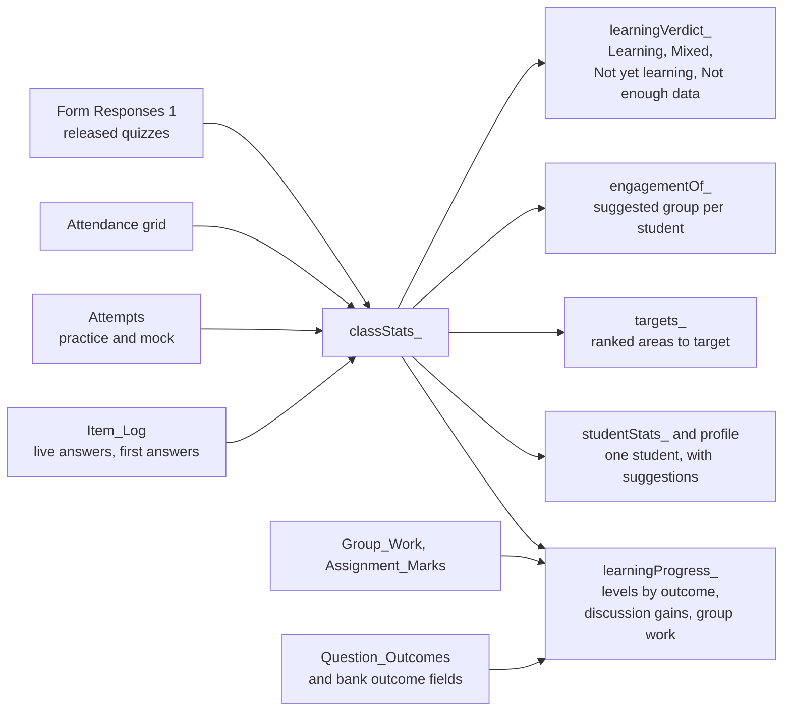

**Class verdict.** Signals are scored +1, 0 or -1, each with its sample size. Direct evidence counts twice: (1) the same questions answered again later (pairs of first and latest answers; at least 30 pairs; +1 at a gain of 10 points or more, -1 at a fall of 5 or more), and (2) the trend of class quiz means (at least three quizzes with 10 or more students; slope of 3 points per quiz). Indirect evidence counts once: persistent shared wrong answers, quiz participation, and attendance (recent against earlier). A verdict requires at least one sufficient direct signal; "Learning" requires a total of 2 or more and no negative direct signal. Confidence is "moderate" with two direct signals and no small samples, otherwise "low".

**Engagement groups (lecturer only).** Effort is the mean of attendance rate, share of live quizzes taken and recent practice (100 or 0). Performance is the quiz average, or the practice average. With defaults effort 70 and performance 50: On track; Working hard but struggling; Disengaged; Needs a check-in; Not enough data.

**Areas to target.** Topics judged "Not yet learning" or "Mixed" under 60 per cent, questions with a shared wrong option (a third or more of answers, weighted up when it persists), and questions with low discrimination, each with its evidence, sample size and a suggested action.

**Progress by outcome.** Questions are linked to a lecture's learning objective (lecturer tag first, then the bank's own field). Levels: Secure (70 per cent or more), Developing (50 or more), Beginning, and Not enough evidence (fewer than 3 answers).

**Ask, discuss, revise.** For each discussed question: proportion correct before and after, how answers moved, and normalised gain `(after - before) / (100 - before)`.

### 8.2 At-risk rule (`app/dashboard/risk.js`)

A student is at risk when at least one reason below holds. A reason built on little data is labelled "thin evidence" rather than strong.

| Reason | Rule | Thin when |
|---|---|---|
| Attendance | Attendance under the effort threshold (default 70 per cent of submitted sessions) | Fewer than 4 sessions submitted |
| Missed in a row | Absent from the last 2 or more sessions (setting `misses`) | Fewer than 4 sessions |
| Quiz average | Average under the performance threshold (default 50 per cent) over at least 2 quizzes | Fewer than 2 quizzes |
| Took none | Took none of the quizzes released (needs at least 2 released) | Fewer than 2 quizzes |
| Fall | Latest quiz at least 15 points under the one before | Always thin |

The "who needs attention first" queue scores: missed in a row 40 plus 5 per session; working hard but struggling 35; disengaged 30; needs a check-in 25; fall of 15 points or more 20. Settings: `effort` 70, `perf` 50, `idle` 14, `misses` 2.

### 8.3 Evidence confidence (`app/analytics/evidence.js`)

| Students behind a figure | Label |
|---|---|
| Under 5 | Too little |
| 5 to 9 | Low |
| 10 to 29 | Medium |
| 30 or more | High |

Coverage lowers the label by one level when under half the class is covered, and caps High at Medium when under 80 per cent is covered. The label and the reason are shown beside the figure. A class under 10 students is shown amber with the reason.

### 8.4 Other cards and traffic lights

| Card | Definition |
|---|---|
| Top row of five numbers (`dashboard/rules.js`) | Students, Attendance, Learning, Practice, At risk. Attendance light: red under 60 per cent, green from 80, amber between; Practice has no light. Each number opens the chart behind it, and each bar or zone lists its students. |
| Trends | Attendance, quiz mean, quiz participation and learning gain; a trend needs three points, otherwise it says so. |
| Question review (`items.js`) | Judged from 10 answers. Flags: more students chose a wrong option than the keyed answer (check the key); 20 per cent correct or less (very hard or unclear); 90 per cent or more (very easy); at least 3 students sure and wrong and at least a fifth of those giving a confidence (likely misconception). |
| Topics (`concepts.js`) | Too early under 30 answers; revisit under 60 per cent; developing 60 to 79; secure from 80. A gap of 15 points or more between live and practice is noted. |
| Support given (`interventions.js`) | Later quiz change for students given support against those not, worded as an association. |
| Results by teaching group (`fairness.js`) | Groups of at least 10 students; a gap of 10 points or more is flagged as a prompt to check teaching conditions, not as a finding. |
| Relations (`dashboard/groups.js`) | Always shown with n and r and the words "association, not proof of cause"; under 5 students not drawn. |
| Class graphs (`app/charts/`) | Distribution with fitted Gaussian curve, mean and one SD either side, outliers beyond 1.5, 2 and 3 SD; box plot per measure; attendance against quiz average scatter (stated in words only from 10 students); mastery per objective; heat map of students by objective; progress over time; learning gain; nine extra clickable bar charts. Fewer answers than the minimum is shown as "not enough evidence", never as a low score. Colour is never the only signal, and every chart offers its numbers as a table. |
| Weekly summary (`summary.js`) | Built from class totals only, written locally; Claude wording only when the lecturer switches it on and a key is stored (off by default). |

---

## 9. Privacy and security

| Who | Credential | Where checked | Limits |
|---|---|---|---|
| Lecturer | Host key (16 hexadecimal characters from a UUID at setup), replaceable by the lecturer's own password of 10 to 100 characters, stored only as a salted slow hash `pw1:rounds:salt:hash` (4,000 rounds); a recovery code is shown once and kept as a hash | `hostOk_`, `06-password.gs` | 10 wrong passwords lock sign-in for 10 minutes; 5 wrong recovery codes an hour; lost both: the Sheet owner runs `resetHostKey()` or uses CM's Reset |
| Student, own record, messages, group work, check-in | Student ID on the roster and personal access code (printed slips; codes can expire) | `portalResults_`, `chatWho_`, `groupWork_`, `attCheckIn_` | `ATT_MAX_FAILS` 6 per ID in ten minutes; 200 failed sign-ins across the whole class in ten minutes |
| Student, live quiz | Join code shown in class, first name and ID | Presence and round rules | First submission counts |
| CM screens `/app/*` | Request from this computer | `isThisComputer` in `main.js`; never through the tunnel | |
| Visitors through the tunnel | None | Rate limit per visitor; lecturer requests refused unless allowed | 240 requests a minute; address stops after 3 hours by default |

**What is kept.** Student IDs, names from the class list, answers, confidence ratings, attempts, attendance, salted device hashes, group work and peer ratings, messages, notes and the calendar, in the lecturer's encrypted course database.

**Protection at rest.** Rows are sealed with AES-256-GCM; the data key is wrapped by the system keychain (Electron `safeStorage`) where available, otherwise kept with owner-only permissions and CM says the records are not keychain-protected. IDs in the student table are held as a keyed fingerprint. Backups are sealed the same way; a backup file uses a passphrase (scrypt). Credentials for linked services are kept only on this computer, encrypted by the keychain.

**Governance** (`governance.js`, Privacy and records card). An Audit_Log tab records every sensitive action (export, erase, term close, role use) with no marks or answers. For one student ID the lecturer can export everything held, tab by tab, or erase it permanently (the ID must be typed to confirm; this cannot be undone). Closing the term stops student writes (check-ins, quiz attempts, reports, chat) and never the lecturer's reading and export. A default privacy notice is served to students: what is held, why, who sees it, how long, their rights, and whom to ask. Roles: lecturer (read, write, export, erase, term, settings), assistant (read class only), student (own record).

**What is never stored or sent.**

- No secret is in the repository or in a page; credentials never travel in a web address.
- Raw device tokens are never stored, only a salted hash. The phone's coordinates are not stored; the web version writes only the outcome of the location check, and CM has location checking off because phones share location only over https.
- Nothing about students is sent to Anthropic. Requests carry only the lecturer's documents, instructions and existing question stems.
- The AI snapshot uses pseudonyms, no names by default, an allow-list of tabs, and drops columns named like a key, code, secret, device, e-mail or phone.
- The LMS receives its own user id and points only. The mailbox holds sealed items only.
- Engagement groups, peer ratings, levels and suggestions are shown to the lecturer only. Public rankings show first names and scores only; projector lists use first names.

**Further measures.** Typed values beginning `=`, `+`, `-` or `@` are prefixed so a sheet does not run them as formulas. Imported and generated question text is escaped, with a small allow-list of tags. CM windows run sandboxed and external links open in the system browser. Static paths are confined to the web root. The downloaded `cloudflared` runs only if its SHA-256 matches the value in `tunnel.js`.

---

## 10. User interface design

### 10.1 Screens and navigation

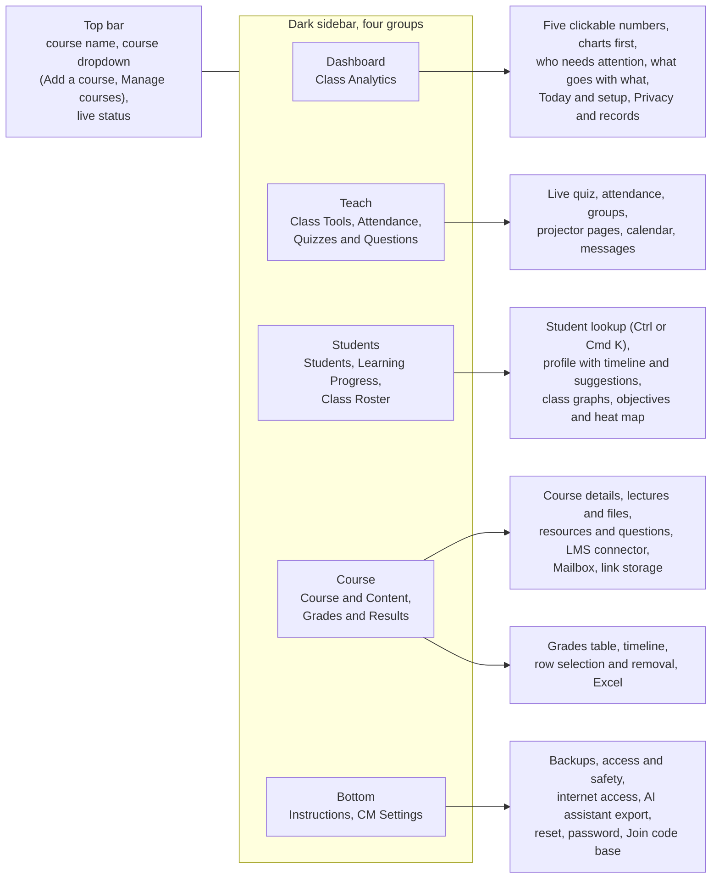

The CM window has ten views, each in `app/home.html` as a section named `v-<view>`: Class Analytics, Students, Learning Progress, Attendance, Quizzes and Questions, Class Tools, Course and Content, Class Roster, Grades and Results, CM Settings. Instructions open the manual. A course dropdown in the top bar chooses the course; every screen in that window then shows that course only, and "Add a course" and "Manage courses" add, rename, archive and restore courses and link a course to its own folder. The setup screen (`app/setup.html`) appears on first launch and offers three ways to begin: start from scratch, use a template, or continue from existing data (plus "Load from a folder"). Authoring (`app/author.html`) is a separate window for the resource library, summaries, question generation, import, writing and review. Lecturer pages for the room (attendance QR code, quiz host, projector displays, access code slips) are web pages opened from Class Tools; the student pages are the same pages the web version serves.

### 10.2 Look and layout rules

- **Theme.** Dark and light both ship and follow the system setting (`prefers-color-scheme`). Dark: background `#0E131C`, sidebar `#0B1018`, panel `#131924`, card `#1B2333`, line `#2A3650`, text `#E6ECF5`, muted `#A3AFC2`, headings `#F4F1EA`, gold accent `#C9A15A` (actions), primary blue `#2F62AE`, danger `#B4473C`, ok `#4CC38A`, warn `#E0B254`, focus `#F2C9A0`. Light: background `#EEF2F8`, sidebar navy `#16294B`, card white, text `#1F2D45`, headings `#16294B`, primary `#1F3A68`, accent and focus `#7A4A2A`. All screens use these tokens (`--bg`, `--card`, `--accent` and so on), so a change is made in one place.
- **Class Analytics look** (from the lecturer's inspiration image of 15 November, no logos copied): soft tinted tiles whose tint is a mix of the tile's colour (blue, green, purple, orange, red) with the card colour; large readable numbers (2.1 rem); line icons; a row of four class tool tiles; one insight callout; a dark sidebar. Gold stays for actions.
- **Charts first.** Numbers are buttons that open the chart behind them; tables are the drill-down. Long lists show the first 8 and a "Show all" button.
- **Traffic lights always carry a word**, never colour alone. Charts offer a table view and a text label. The lists of students never reach the projector view.
- **Sizes.** Radius 12 px, gap 1.25 rem, padding 1.5 rem, headings 1.3, 1.75 and 1.08 rem, small text 0.9 and 0.8 rem. The system font stack is used (`system-ui`). The window is tested at 760, 1000 and 1280 px.
- **Overflow guard.** `test/overflow.test.js` opens every sidebar screen at 760, 1000 and 1280 px with a very long folder path and repository URL and fails if the page or `main` scrolls sideways. Long values are shown in labelled lines (Folder, Repository, Branch) with Copy buttons.
- **Accessibility.** A view has a heading for screen readers; focus is visible (`--focus`); charts have text labels and table fallbacks; a full keyboard and screen reader audit of the student pages and the projector has not been done.
- **Wording.** Formal, plain sentences; "CM", never "the app"; no ampersand in text; a blank is "no record", never zero; a small sample is "not enough evidence", never a low score.

### 10.3 Student and projector pages

Phone pages are static pages that read `config.js`: portal (this week's lecture, check-in, live quiz, My results), course and lecture pages, practice, mock examination, calendar, messages and group work. They show the outbox state ("saved", "received", "held") after a practice result. Projector pages show the quiz (question, option shares, review, before and after spreads for discussed questions), the group lists (first names) and the rotating attendance QR code.

---

## 11. Configuration

| Where | Setting | Effect |
|---|---|---|
| `config.js` | `courseCode`, `courseTitle`, `institution`, `scriptUrl` | Labels; server address (mode A). Generated by CM per course in modes B and C, with `desktop: true`, `publicBase` when the tunnel is on, and the mailbox address when it is on |
| CM Settings | Port, zoom, internet limits (time, lecturer requests through the internet address), records protection and backups, link storage, AI assistant export, reset, password | `settings.json` |
| Course details | Labels, lecturer, semester, contact, accent, logo, notice, optional Apps Script address | `courses/<id>/settings.json` |
| `quiz_receiver.gs` constants | `SITE`, `NOTIFY_EMAIL`, `GRACE_MS`, `ATT_*` (slot 30 s, grace 2 slots, code, phone binding, location mode and radius), `SESSION_HOST_HOURS` 8, `SESSION_STUDENT_DAYS` 14, `SIGNIN_GLOBAL_MAX` 200, `PW_*`, `CHAT_*`, `LEARN_MIN_*`, `PROG_*` | CM sets `ATT_GEO_MODE = 'off'`, `SITE`, and empty `NOTIFY_EMAIL` |
| Key tab and script properties | Host key or password hash, Totals rule (K2), Master on or off (L2), live quiz week, `join_base` | Join code is the base followed by the week number |
| Request parameters | `effort`, `perf`, `idle`, `misses` | Statistics thresholds, kept per lecturer |
| `data/lectures.json`, `apps_script/live_quizzes.json` | Lectures, titles, outcomes, files; weeks | Lecture pages; which banks the live quiz may draw from |

---

## 12. Build and release

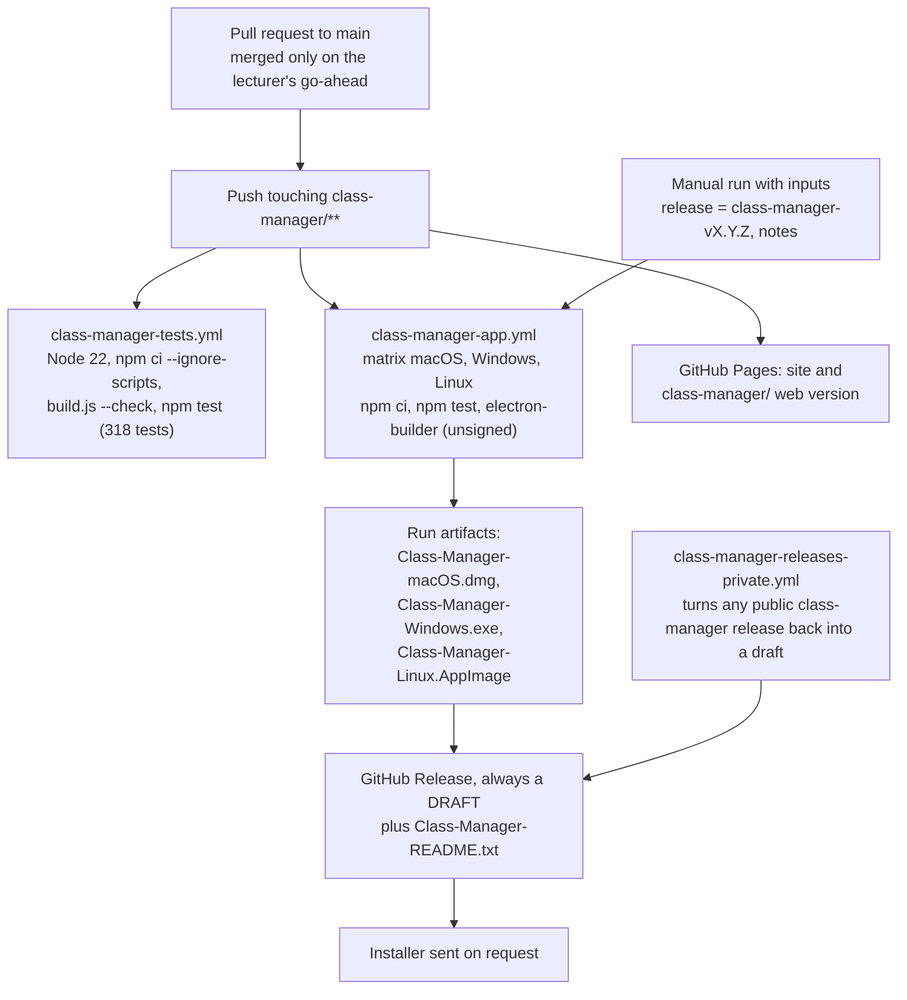

- **Pages.** No build step. The web version of CM pages deploys with the site.
- **Desktop.** Electron 44.9.3, electron-builder 26.18.0, Node 22 in CI. The bundle holds the desktop modules in `app.asar` and the pages in `resources/web`, excluding `desktop/`, `tools/`, `course-packs/` and the documents. `test/packaging.test.js` checks that every module is listed. Installers are unsigned (macOS uses an ad hoc signature); Windows shows "Windows protected your PC" and macOS asks the user to open with a right-click.
- **Versioning.** `desktop/package.json` version and the release tag; `SCRIPT_VERSION` in the server script must match what `control.html` expects.
- **Web deployment.** For the web path the lecturer pastes `quiz_receiver.gs` into the Sheet's Apps Script project and deploys a new version (`apps_script/REDEPLOY.md`). `normId_` changed in PR #96 and `quiz_receiver.gs` changed in 0.21.0, so a redeploy is needed for the web path to match.

---

## 13. Testing

| Suite | Coverage |
|---|---|
| `npm test` in `class-manager/desktop` (`node --test test/*.test.js`, 40 test files) | 318 tests, all passing on this commit, run in CI on every push and pull request that touches `class-manager/`. Areas: class statistics and verdicts, pedagogy (second vote, groups, assignments), access and attendance guards, analytics, dashboard and charts, governance, summary, LLM snapshot, LMS (against a mock LMS), import and Excel, folder autoload, courses and migration, vault and backups, link storage and sync, SQLite store and migration (`db.test.js`), duplicate IDs by every entry path (`duplicate-ids.test.js`), mailbox (`mailbox.test.js`, with the Worker code and a fake store), grades table (`grades.test.js`), reset and removal, overflow at three widths, packaging, and loading `main.js` |
| `node apps_script/build.js --check` | The server script equals the build of its modules |
| `tools/validate_quizzes.py`, `check_calcs.py`, `test_practice.mjs` | Bank schema, recomputed calculations, practice engine (course pack tools) |

**Not tested.** CM in the installed, signed-off state (no click test of the installers), `node:sqlite` inside the packaged Electron 44, phones against a real Cloudflare Worker, the Cloudflare quick tunnel against real Cloudflare, link storage against a real cloud account, the LMS direct connection against a real LMS, the server script on Google Apps Script after its latest changes, and generation against the real Anthropic API. Earlier sessions recorded 16 failing practice-page checks in `tools/test_practice.mjs` (wording and links); their current state was not re-run for this document.

---

## 14. Repository layout

`STRUCTURE.md` holds the full file map; this is the summary.

| Place | Holds |
|---|---|
| `class-manager/` (pages, `assets/`, `config.js`, `sw.js`) | Student, lecturer and projector pages and shared scripts |
| `apps_script/` | `quiz_receiver.gs` built from `src/` (eleven modules) by `build.js`; `live_quizzes.json` |
| `relay/` | The mailbox Worker and its setup steps |
| `desktop/` | CM: `main.js`, `backend.js`, `courses.js`, `vault.js`, `access.js`, `governance.js` and so on |
| `desktop/db/`, `grades/`, `lms/`, `llm/`, `relay/`, `sync/`, `storage/`, `autoload/` | One module folder each, each with a README (db, grades, lms, llm, autoload, relay setup) |
| `desktop/app/` | Screens; `analytics/`, `dashboard/`, `charts/` hold the analytics views, each with a README |
| `desktop/test/` | Tests beside the code |
| `course-packs/phys143/`, `templates/`, `data/` | The PHYS 143 source and the empty course |
| `../.github/workflows/` | `class-manager-tests.yml`, `class-manager-app.yml`, `class-manager-releases-private.yml` |

Standing rule for every change: modular code (one responsibility per file, clear names, short functions, no giant files), a short README per module, tests, `STRUCTURE.md` and this document updated, and code a non-specialist can change. Several files are still large (`main.js` 871 lines, `quiz_receiver.gs` 3,757 lines as built).

---

## 15. Not done yet, known limits and risks

### 15.1 Not done yet

| Item | State |
|---|---|
| Screen for duplicate-ID notices | Notices exist (`backend.idNotices()`); no screen shows them |
| Editable column mapping and a group for ambiguous IDs when uploading files | Not built; columns are found automatically and shown in the preview |
| Removal of the Apps Script path | Deliberately kept; Google Sheets stays optional |
| Click test of CM in the real window on all three systems | Not done |
| Provider-neutral question generation and an "ask about my class" panel | Not built (each would send data from CM and needs its own consent step) |
| Screenshots of the new Grades row-selection bar | None yet |
| Version number | `package.json` 0.21.3 against 0.21.4 in `STRUCTURE.md` |

### 15.2 Known limits

1. **Desktop reach.** In mode B students reach CM only while it is open; the tunnel address changes at each start, so calendar subscriptions to it do not last. The mailbox covers only practice results and reports.
2. **Cloudflare quick tunnel** is described by Cloudflare as a testing service with no uptime guarantee and about 200 requests in flight; usually enough for one class.
3. **Polling.** Messages poll every 8 seconds; in the web version each poll is an Apps Script execution.
4. **Whole-tab reads.** Statistics and chat read whole tabs on each request; cost grows with the term.
5. **One large script.** 3,757 lines as built, though edited as eleven modules; tab layouts are positional.
6. **Downgrade.** After the move to the course database CM must not be downgraded.
7. **Unsigned installers.** Windows and macOS warn on first launch.
8. **Google sign-in.** The OAuth client for the Drive copy (`google-oauth.json`) is not registered.
9. **Learning evidence.** No pre-test or concept inventory; learning is judged from repeated questions and quiz results.
10. **Phone cache.** A phone that cached `assets/` through `sw.js` may need a refresh to get the outbox.
11. **Preview images.** `preview-pedagogy/` screenshots ship inside `class-manager/`, so they are published with the web version and bundled into installers.

### 15.3 Risks (judgement)

- **Storage change in production.** `node:sqlite` in Electron 44 and the migration from `workbook.json` are covered by tests but not by a click test in the installed CM. Mitigation in the design: the original file is kept, a backup is taken first, and an unreadable database is moved aside, never overwritten.
- **Mailbox trust.** The Worker needs the lecturer to deploy it correctly; `DROP_TOKEN` is public in the course page by design, so its protection is the 16 KB and 1,000 item limits and encryption, not secrecy.
- **Duplicate ID handling is silent unless noticed.** Merges are reported only through `idNotices()` until a screen exists.
- **Analytics are associations.** Thresholds are lecturer-set defaults; thin evidence is labelled, but a lecturer may still act on a thin flag.
- **Institutional use.** No data processing agreement, retention schedule or legal review exists.

