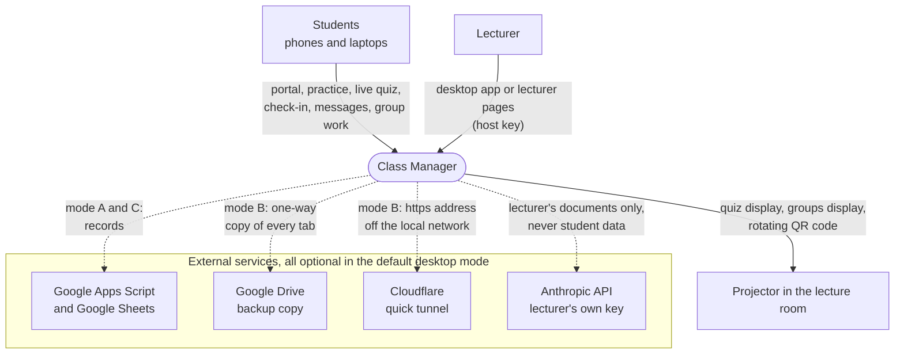
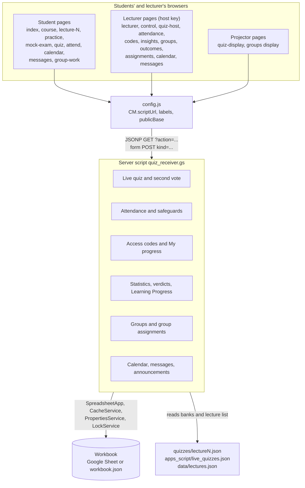
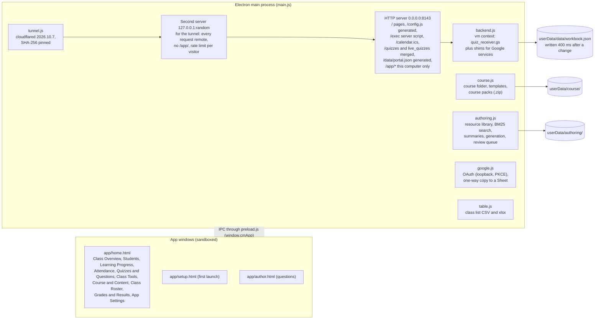
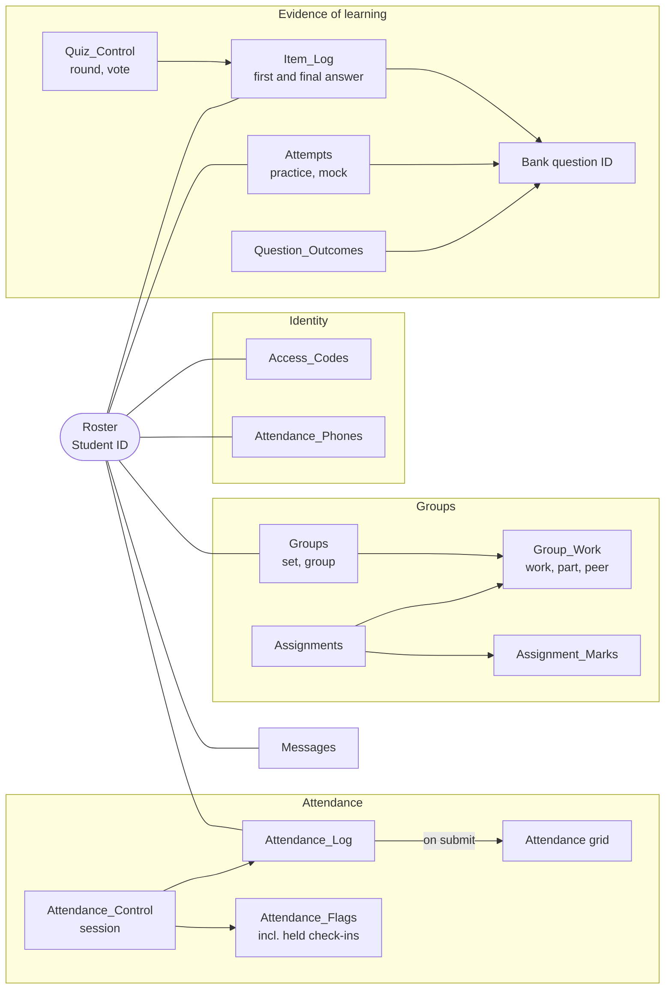
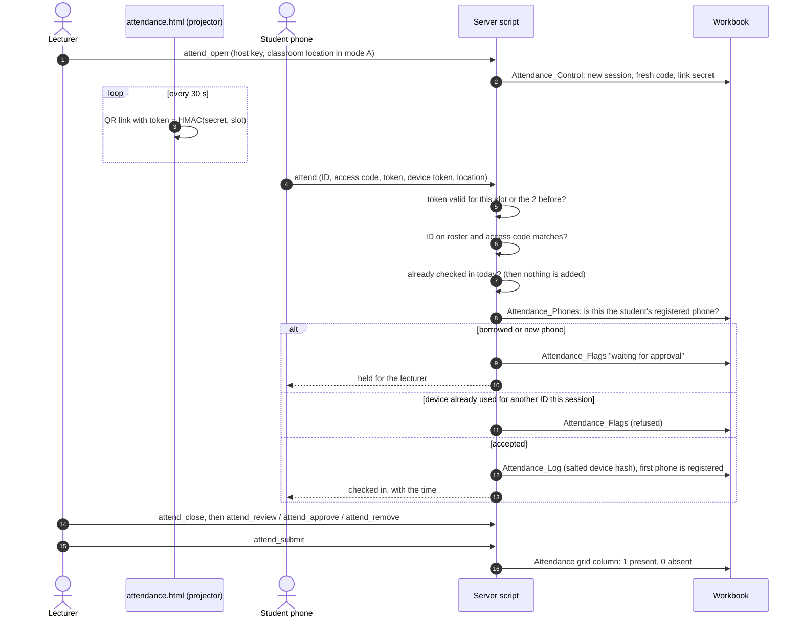
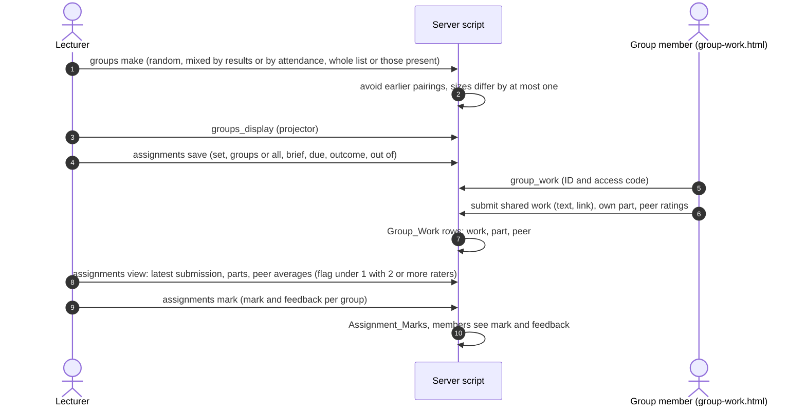
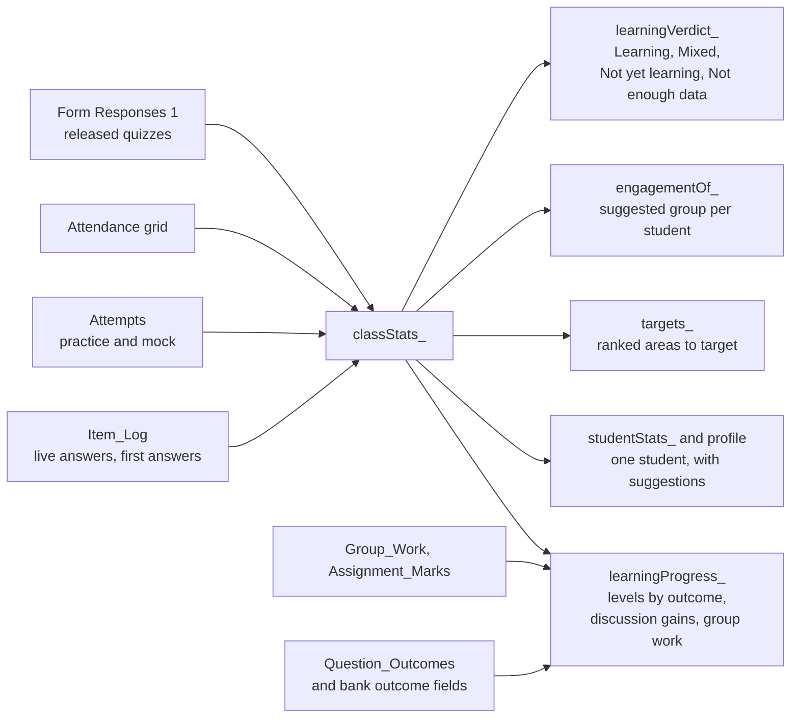
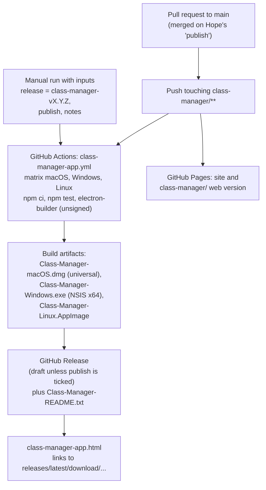
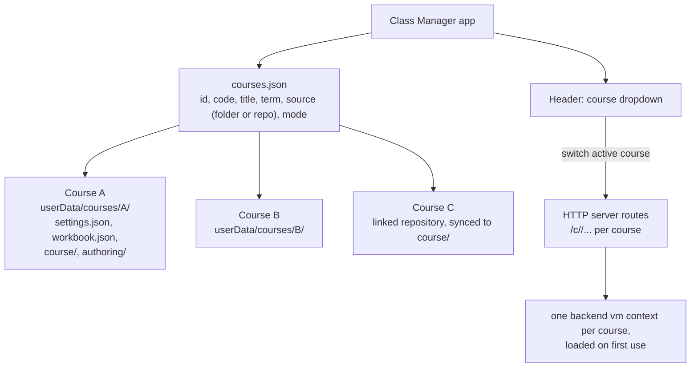

# Class Manager: system architecture

Version 0.7.0, written 10 November 2026 from `main` at commit 25f153b ("Class Manager 0.7.0: teaching for learning"). Every statement below was checked against the source. Statements of judgement are confined to Sections 14 and 15 and are labelled as such.

## Contents

1. Purpose and scope
2. System context
3. Components and deployment modes
4. The desktop application
5. Data model
6. Server interface (API)
7. Main flows
8. Statistics, verdicts and progress
9. Security and privacy model
10. Configuration
11. Build, release and distribution
12. Testing
13. Repository layout (summary; detail in STRUCTURE.md)
14. Known limits
15. Weaknesses and suggested improvements, for review
16. Future direction: one application for many courses

---

## 1. Purpose and scope

Class Manager gives a lecturer insight into how a class is learning, and supports student-centred teaching on that evidence. Attendance, live quizzes, practice and group work are the means of collecting the evidence; the purpose is the insight that follows from it: which topics the class has learned, which misconceptions persist, which students need attention, and whether discussion between students changes their answers.

The system serves one course per installation. It ships with no course content: course details, lectures, files and question banks are loaded by the lecturer, by hand or from a course pack. PHYS 143 is kept as a course pack source in `class-manager/course-packs/phys143/` and is not part of the application.

## 2. System context

Students never need an account. The lecturer needs no account in the default desktop mode; every external service is optional. Installers reach lecturers through GitHub Releases and the download page (Section 11).

## 3. Components and deployment modes

The system has three layers, and the same server script serves all of them.

1. **Pages.** Static HTML and plain JavaScript in `class-manager/`, with no framework and no build step.
2. **Server script.** `apps_script/quiz_receiver.gs` (3,437 lines, `SCRIPT_VERSION` `2026-11-10-pedagogy-1`) holds every rule: scoring, attendance, access, statistics, groups, assignments, calendar and messages. It answers `doGet` (JSONP reads and lecturer actions) and `doPost` (submissions).
3. **Workbook.** Every record, one tab per kind of record: a Google Sheet, or `workbook.json` on the lecturer's computer.

| Mode | Pages served from | Server script runs in | Records kept in | Reach |
|---|---|---|---|---|
| A. Web | Any static host (GitHub Pages) | Google Apps Script web app bound to a Google Sheet | The Google Sheet | Anywhere with internet |
| B. Desktop, local (default) | The app's HTTP server, port 8143 | Node `vm` inside the Electron main process (`desktop/backend.js`) | `workbook.json` in the app's data folder | The local network while the app is open; anywhere through the optional tunnel |
| C. Desktop with an Apps Script address | The app's HTTP server | Google Apps Script (Settings, advanced) | The Google Sheet | Pages on the local network; records online |

In mode A the script reads the banks over HTTP from `SITE`. In modes B and C the desktop server answers those paths itself, merging the course banks with the lecturer's approved questions.

## 4. The desktop application

**Screens.** The home window has ten views. Class Overview, Students, Attendance, and Quizzes and Questions are drawn by `app/insights.js` from `classStats_` and `studentStats_`. Learning Progress and the student lookup (Ctrl or Cmd K) are drawn by `app/progress.js` from `learningProgress_` and the student profile. Class Tools opens the live quiz, attendance, groups and projector pages in the system browser. Course and Content, Class Roster, Grades and Results, and App Settings manage the course folder, the class list, the tabs and the settings.

**IPC surface** (`preload.js`, a fixed list): `cm:info`, `cm:live`, `cm:stats`, `cm:progress`, `cm:readme`, `cm:save`, `cm:setup`, `cm:lectures`, `cm:tab`, `cm:export`, `cm:run`, `cm:search`, `cm:summarise`, `cm:generate`, `cm:banks`, `cm:drafts`, `cm:approve`, `cm:withdraw`, plus the course, Google and tunnel calls.

**Internet access.** `tunnel.js` downloads `cloudflared` once from Cloudflare's GitHub releases, checks its SHA-256 against a fixed table, and starts a quick tunnel to the second server. While the tunnel is on, `config.js` carries `publicBase`, so QR codes and links point to the `https://*.trycloudflare.com` address. A phone hotspot is the documented alternative when campus Wi-Fi isolates devices.

## 5. Data model

### 5.1 Workbook tabs

Student ID is the key that joins the tabs. Tabs are created by `setup` (mode A) or on first use.

| Area | Tab | One row per | Key fields |
|---|---|---|---|
| Settings | Key | Join code | Join code, correct letters, ranking; J2 host key (`sha256:salt:hex` once changed); K2 Totals rule (Best or Latest); L2 Master on or off; live quiz week |
| Class list | Roster | Student | Student ID, name |
| Live quiz | Quiz_Control | Lecturer-run quiz | join_code, status (Draft, Ready, Lobby, Running, Paused, Ended, Released), timers, mode, round, review_q, n_questions, question_ids, week, **vote** (1 or 2), **discussed** (questions that had a second vote) |
| | Presence | Join | ID, first name, code, joined, submitted |
| | Answers | Answer | ID, code, question, letter, round, confidence |
| | Staged_Quiz | Student per quiz | Marked results held until release |
| | Form Responses 1 | Released attempt | Timestamp, first name, ID, join code, Q1 to Q5, score, round, questions, answers, week |
| | Item_Log | Student per live question | Timestamp, join code, round, week, ID, Q, question ID, answer, correct answer, correct, confidence, **first answer**, **discussed** |
| | Explanations | Question | Optional explanation overrides |
| Marks | Master, Scores, Totals | Student | One column per quiz; rebuilt on release |
| Practice | Attempts | Practice or mock attempt | Timestamp, ID, quiz, attempt, score, total, seconds, wrong question IDs, question IDs asked |
| | Reports | Reported problem | Lecture, question ID, question, answer shown, comment, page |
| Attendance | Attendance_Control | Session | Code, label, status, opened, closed, link secret, classroom location |
| | Attendance_Log | Accepted check-in | Timestamp, session, ID, on roster, salted device hash, location result (distance only) |
| | Attendance | Student | One column per submitted session: 1 or 0 |
| | Attendance_Flags | Flag | Session, ID, device hash, reason (wrong code, device reuse, location, or "waiting for approval: ...") |
| | Attendance_Phones | Student | Student ID, salted device hash, registered |
| | Not_On_List | Unknown ID | IDs that checked in but are not on the roster |
| Learning | Access_Codes | Student | Student ID, personal code `XXXX-XXXX` (no 0, O, 1, I or L), issued |
| | Question_Stats | Question | Proportion correct, discrimination, label |
| | Question_Outcomes | Question | Question ID, lecture, outcome number, set |
| Groups | Groups | Student per set | Set, group, ID, name, group mark, out of, locked, created |
| | Assignments | Assignment | ID, set, groups (`all` or a list), title, brief, due, outcome, out of, status |
| | Group_Work | Submission event | Time, assignment ID, set, group, ID, kind (`work`, `part`, `peer`), text, link, rating |
| | Assignment_Marks | Group per assignment | Assignment ID, group, mark, feedback, marked |
| Communication | Calendar | Event | Event ID, title, kind, start, end (local text), all day, location, agenda, resources, week, linked session, visibility, series |
| | Messages | Message | Message ID, time, conversation, from, name, text, status, removed by |
| | Chat_Groups, Chat_Read | Group; reader per conversation | Members and owner; last read time |
| | Announcements | Announcement | Title, text, audience, pinned, show from, link, event ID, status |
| Audit | Log | Event | Every submission outcome and lecturer action |

**Script properties.** `draw_salt` (a random value per workbook mixed into the question draw) and the chat settings (`chat_mode`, `chat_dm`, `chat_groups`, `chat_rules`, `chat_muted`).

**Conversation IDs.** `CLASS`; `L:<set>|<group>` (a lecturer-made group); `S:<id>` (a student-made group); `DM:<studentId>`; `P:<idA>:<idB>`.

### 5.2 How the records relate

### 5.3 Local storage on the lecturer's computer (modes B and C)

The app data folder (`userData`, for example `~/Library/Application Support/Class Manager` on macOS) holds:

- `settings.json`: course labels, lecturer, semester, contact, accent, logo, notice, optional Apps Script address, port, zoom, first-launch state;
- `data/workbook.json`: every tab and the script properties (dates as `{$d: ISO}`), written 400 ms after a change;
- `course/`: the course folder (`data/lectures.json`, `data/portal.json`, lecture files, `quizzes/lectureN.json`);
- `authoring/`: the resource library (`library/<id>.chunks.json`, `index.json`), `drafts.json`, `settings.json` (model), and `banks/lectureN.json` (approved questions);
- `google.bin` and `anthropic.bin`: OAuth tokens and the API key, encrypted with the system keychain (`safeStorage`) where available;
- the downloaded `cloudflared` program.

### 5.4 Storage in students' browsers

`localStorage`: practice progress, the remembered Student ID and access code (optional), the device token used for attendance. `sessionStorage`: the host key on lecturer pages. The service worker (`sw.js`) caches the portal shell.

## 6. Server interface (API)

All reads and lecturer actions are JSONP `GET ?action=...&callback=...`. Submissions are form `POST` with `kind=...`. In the desktop app both arrive at `/exec`.

**Public or student actions (no host key).**

| Action | Purpose | Check |
|---|---|---|
| `status`, `questions`, `review`, `ranking`, `result`, `display` | Live quiz state (cached 3 s), questions without answers (cached 120 s), review with before and after spreads, first-name ranking, own result, projector | Join code; Student ID where relevant |
| `portal_status` | What is open now | None |
| `my_results` | A student's attendance, quizzes, practice, progress by lecture and by outcome, revisit list, groups | Student ID and access code; 6 failures lock the ID for 10 minutes |
| `attend` | Check in | QR token, access code, device token, phone binding, location (mode A) |
| `group_work` | The student's group assignments; submit work, own part, peer ratings | Student ID and access code |
| `calendar`, `calendar_ics` | Student-visible events; iCalendar file or feed | None (host key adds lecturer-only events) |
| `announcements`, `chat` | Announcements; conversations and messages | None, or ID and access code, or host key |
| `hostcheck`, `version` | Key check; script version | None |

**Lecturer actions (host key).**

| Area | Actions |
|---|---|
| Live quiz | `control` (open, start, pause, next, **revote**, end, release, reset), `host`, `held_status`, `held_release_quiz`, `held_discard_quiz`, `set_week`, `preclass` |
| Attendance | `attend_open`, `attend_close`, `attend_status`, `attend_submit`, `attend_discard`, `attend_review`, `attend_approve`, `attend_remove`, `attend_phone_reset` |
| Class list | `roster_edit`, `roster_tidy`; POST `roster_sync` |
| Learning | `insights`, `class_stats`, `student_stats`, `learning_progress`, `access_codes`, `outcomes` |
| Groups | `groups` (make, move, lock, mark, delete, list), `groups_display`, `assignments` |
| Communication | `calendar_edit`, `announcements` with `op`, `chat` with `op` (moderation) |
| Key | `setkey` (12 to 40 characters, stored as salted SHA-256) |

**POST kinds.** `join`, `progress`, `answer` (with confidence), `attempt` (practice and mock, with question IDs), `report`, `roster_sync`.

**Concurrency.** Writes take `LockService.getScriptLock()`. Check-ins use an atomic append and take no lock. Hot reads are cached in `CacheService` (quiz status 3 s, open attendance session 5 s, questions 120 s, chat version stamp).

## 7. Main flows

### 7.1 Attendance with anti-proxy safeguards

Safeguards, in order of application: the rotating QR token (30-second slots, two slots of grace), six failures per device or ID before a pause, the personal access code, one check-in per ID per day, one phone per student for the term (a borrowed or new phone is held, never counted on its own), one ID per device per session, and the location check (mode A only, 500 m radius, enforced; off in the desktop app because phones give location only to https pages). Nothing reaches the Attendance grid until the lecturer submits.

### 7.2 Live quiz with ask, discuss, revise

```mermaid
sequenceDiagram
  autonumber
  actor L as Lecturer (quiz-host)
  participant SV as Server script
  actor S as Students (quiz.html)
  participant D as Projector (quiz-display)
  L->>SV: control open (week, N, timing) then start
  SV->>SV: draw N questions, seeded by join code, round and draw_salt
  S->>SV: join (first name, ID, code)
  loop each question
    S->>SV: answer (letter, optional confidence)
    opt answers split: ask, discuss, revise
      L->>SV: control revote
      SV->>SV: vote = 2, question added to discussed
      D->>D: "Discuss with your neighbour, then vote again"
      S->>SV: answer again (the first answer is kept)
    end
    L->>SV: control next
  end
  L->>SV: control end
  SV->>SV: mark on the server, Staged_Quiz, Item_Log with first answer and discussed flag
  L->>SV: control release
  SV->>SV: Form Responses 1, rebuild Master, Scores, Totals
  D->>D: review: option shares, before and after spreads for discussed questions
```

The score uses the final vote. Answer letters never reach the student page before review. The first submission per ID and join code in a round counts; 15 seconds of grace are allowed after a deadline.

### 7.3 Groups and group assignments

Peer ratings (Contributed fully, partly, little; scored 2, 1, 0) are shown to the lecturer only.

### 7.4 Practice, the mock examination and My progress

Practice and the mock examination run in the browser from `quizzes/lectureN.json`. If the student enters an ID, `tracking.js` posts each attempt (score, time, question IDs asked and missed) to Attempts. Attempts join Master and Scores at the next release, for IDs on the roster only. My progress (`my_results`) opens only with the ID and the access code and shows the student's own record, progress by lecture and by learning outcome, and the questions to revisit with the slide to look at.

## 8. Statistics, verdicts and progress

All figures are computed in the server script from the tabs above; nothing is estimated or stored by the pages. The lecturer sets the thresholds.

**Class verdict.** Signals are scored +1, 0 or -1, each with its sample size. Direct evidence counts twice: (1) the same questions answered again later (pairs of first and latest answers; at least 30 pairs; +1 at a gain of 10 points or more, -1 at a fall of 5 or more), and (2) the trend of class quiz means (at least three quizzes with 10 or more students; slope of 3 points per quiz). Indirect evidence counts once: persistent shared wrong answers, quiz participation, and attendance (recent against earlier). A verdict requires at least one sufficient direct signal; "Learning" requires a total of 2 or more and no negative direct signal. Confidence is "moderate" with two direct signals and no small samples, otherwise "low".

**Engagement groups (lecturer only).** Effort is the mean of attendance rate, share of live quizzes taken and recent practice (100 or 0). Performance is the quiz average, or the practice average. With defaults effort 70 and performance 50: On track; Working hard but struggling; Disengaged; Needs a check-in; Not enough data.

**Areas to target.** Topics judged "Not yet learning" or "Mixed" under 60 per cent, questions with a shared wrong option (a third or more of answers, weighted up when it persists), and questions with low discrimination, each with its evidence, sample size and a suggested action.

**Progress by outcome.** Questions are linked to a lecture's learning objective (lecturer tag first, then the bank's own field). Levels: Secure (70 per cent or more), Developing (50 or more), Beginning, and Not enough evidence (fewer than 3 answers).

**Ask, discuss, revise.** For each discussed question: proportion correct before and after, how answers moved, and normalised gain `(after - before) / (100 - before)`.

## 9. Security and privacy model

| Who | Credential | Where checked | Limits |
|---|---|---|---|
| Lecturer | Host key: 16 hexadecimal characters from a UUID at setup; can be replaced (12 to 40 characters) and is then stored as `sha256:salt:hex` | `hostOk_` | 30 failures lock it for 10 minutes |
| Student, own record, messages, group work, check-in | Student ID on the roster and personal access code (printed slips from `codes.html`) | `portalResults_`, `chatWho_`, `groupWork_`, `attCheckIn_` | 6 failures lock the ID for 10 minutes |
| Student, live quiz | Join code shown in class, first name and ID | Presence and round rules | First submission counts |
| App screens `/app/*` | Request from this computer | `isThisComputer` in `main.js`; never through the tunnel | |
| Visitors through the tunnel | None | Rate limit per visitor; 429 when exceeded | |

**What is kept.** Student IDs, names from the class list, answers, confidence ratings, attempts, attendance, salted device hashes, group work and peer ratings, messages, and the calendar, all in the lecturer's workbook.

**What is never stored or sent.**

- No secret is in the repository or in a page. The host key exists only in the workbook (hashed once changed).
- Raw device tokens are never stored; only a salted hash.
- The phone's coordinates are not stored. In mode A only the outcome of the location check (near or far, and the distance in metres) is written to Attendance_Log.
- Nothing about students is sent to Anthropic. Requests carry only the lecturer's documents, instructions and existing question stems. Student work is never sent to a model.
- Engagement groups, peer ratings, levels and suggestions are shown to the lecturer only. Students see only their own record.
- Public rankings show first names and scores only.

**Further measures.** Typed values beginning `=`, `+`, `-` or `@` are prefixed so the sheet does not run them as formulas. Imported and generated question text is escaped, with a small allow-list of tags. App windows run sandboxed (`contextIsolation`, `sandbox`, no `nodeIntegration`); external links open in the system browser. Static paths are confined to the web root. The lecturer reads every conversation, and students are told so.

## 10. Configuration

| Where | Setting | Effect |
|---|---|---|
| `config.js` | `courseCode`, `courseTitle`, `institution`, `scriptUrl` | Labels; server address (mode A). Generated by the app in modes B and C, with `desktop: true` and `publicBase` when the tunnel is on |
| App Settings | Labels, lecturer, semester, contact, accent, logo, notice, Apps Script address, port | `settings.json` |
| `quiz_receiver.gs` constants | `SITE`, `NOTIFY_EMAIL`, `GRACE_MS`, `ATT_*` (slot, grace, code, phone binding, location mode and radius), `CHAT_*`, `LEARN_MIN_*`, `PROG_*` | The desktop app sets `ATT_GEO_MODE = 'off'`, `SITE`, and empty `NOTIFY_EMAIL` |
| Key tab | J2, K2, L2, week | Host key, Totals rule, Master, live quiz week |
| Request parameters | `effort`, `perf`, `idle`, `misses` | Statistics thresholds, kept per lecturer in the app |
| `data/lectures.json` | Lectures, titles, outcomes, files | Lecture pages, outcomes for progress |
| `apps_script/live_quizzes.json` | Weeks | Which banks the live quiz may draw from |

## 11. Build, release and distribution

- **Pages.** No build step.
- **Desktop.** Electron 44.9.3, electron-builder 26.18.0, Node 22 in CI. The bundle holds the desktop modules in `app.asar` and the pages in `resources/web` (excluding `desktop/`, `tools/`, `course-packs/`, `README.md`, `STRUCTURE.md`, `ARCHITECTURE.md`). Installers are unsigned; macOS uses an ad hoc signature.
- **Versioning.** `desktop/package.json` version (0.7.0) and the release tag; `SCRIPT_VERSION` in the server script must match the version expected by `control.html`.
- **Mode A deployment.** The lecturer pastes `quiz_receiver.gs` into the Sheet's Apps Script project and deploys a new version of the existing web app.
- **Download page.** `class-manager-app.html` on the main site, under the "Download" menu, with a platform selector; it always serves the latest published release.

## 12. Testing

| Suite | Coverage | Where |
|---|---|---|
| `npm test` (`desktop/test/stats.test.js`, `pedagogy.test.js`, sample classes) | Class statistics, verdicts, engagement groups, outcomes, second vote, group assignments: 24 tests, run against `backend.js` | Repository, run in CI on every build |
| `tools/validate_quizzes.py`, `check_calcs.py`, `test_practice.mjs` | Bank schema, recomputed calculations, practice engine | Course pack tools |
| Browser and end-to-end checks (Playwright against the running and the packaged app) | Pages, attendance safeguards, authoring, calendar, messages | Session scratch files; not in the repository |

Not yet tested: the server script on Google Apps Script itself after 0.5.0, the Cloudflare tunnel against real Cloudflare, and generation against the real Anthropic API.

## 13. Repository layout

See STRUCTURE.md for the full file map. In brief: pages and `assets/` at the top of `class-manager/`; the server in `apps_script/`; the empty course in `data/` and `templates/`; the desktop app in `desktop/`; PHYS 143 in `course-packs/phys143/`; the workflow in `.github/workflows/class-manager-app.yml`; the download page `class-manager-app.html` at the site root.

## 14. Known limits

1. **One course per installation.** Settings, workbook, course folder and banks are single. Section 16 describes the change.
2. **Desktop reach.** In mode B students reach the app only while it is open; the tunnel address changes at each start, so calendar subscriptions to it do not last.
3. **One-way Google copy.** The mode B copy to Drive is a backup and a view, not a migration path.
4. **Polling.** Messages poll every 8 seconds; in mode A each poll is an Apps Script execution.
5. **Whole-tab reads.** Statistics and chat read whole tabs on each request; cost grows with the term.
6. **Secrets in URLs.** The host key and access codes travel as GET parameters (JSONP), and mode B on the local network is plain HTTP.
7. **One large script.** 3,437 lines in one file; tab layouts are positional.
8. **Week range.** `setWeek_` accepts weeks 0 to 12 only; the join code pattern `2627` plus week is written into the script.
9. **End of term.** `clearSemesterRecords` clears Attendance_Log, Not_On_List, Reports, Attempts, Staged_Quiz, Item_Log, Question_Stats and Access_Codes; Groups, assignments, messages, calendar and Attendance_Phones (cleared separately by `attPurgeSemester`) are not part of it.
10. **Unsigned installers.** Windows and macOS warn on first launch.
11. **Google sign-in.** The OAuth client for the desktop copy is not yet registered.
12. **Mode A needs a redeploy** for each script version; 0.7.0 is pending redeployment.
13. **Verdict evidence.** There is no pre-test or concept inventory; learning is judged from repeated questions and quiz results only.

## 15. Weaknesses and suggested improvements, for review

These are judgements, ordered by value relative to effort. Each can be accepted, deferred or dropped.

| # | Weakness | Suggested improvement | Effort |
|---|---|---|---|
| 1 | Browser and end-to-end tests live outside the repository | Commit them under `class-manager/tests/` and run them in the existing workflow | Small |
| 2 | Secrets in GET URLs (history, logs) | Exchange the host key or access code once for a short-lived session token held in memory; send it in POST bodies | Medium |
| 3 | One 3,437-line script with positional columns | Split into files per area (Apps Script allows several `.gs` files; `backend.js` loads them in order) and find columns by header name | Medium |
| 4 | One course per installation | Course registry and course dropdown (Section 16) | Large |
| 5 | Whole-tab reads grow with the term | Cache computed statistics per release; archive messages per term; read recent rows only | Medium |
| 6 | End-of-term clearing is incomplete | One "Close the term" action that exports and then clears every term tab, including groups, assignments, messages and phones | Small |
| 7 | Mode B data on one laptop | Scheduled local backup of `workbook.json`, and mode C offered as the default once signed in to Google | Small to medium |
| 8 | Polling for messages | Server-sent events on the desktop server; keep polling in mode A | Medium |
| 9 | Week range and join code fixed in code | Derive both from `live_quizzes.json` and the course settings | Small |
| 10 | Unsigned installers | Apple Developer ID and a Windows code-signing certificate, signing in CI | Cost, not code |
| 11 | Verdict rests on repeated questions only | Optional short pre-test and post-test per topic, scored as normalised gain | Medium |
| 12 | `preview-pedagogy/` screenshots sit inside `class-manager/`, so they are published with the web version and bundled in the installers | Move them to project files or exclude them in the build filter | Small |
| 13 | Accessibility not audited | Keyboard-only and screen reader pass over student pages and the projector | Small |

## 16. Future direction: one application for many courses

This section describes intended design, not the current system.

**Goal.** One installation manages several courses at once. A course dropdown in the app header switches between them. Each course is linked to its own folder (local) or repository (for example a GitHub repository holding its lecture pages, files and banks).

**What would change.**

1. **Data folder.** Move today's single `settings.json`, `data/workbook.json`, `course/` and `authoring/` into `userData/courses/<courseId>/`, with a `courses.json` registry. A one-time migration moves the existing course into the first slot.
2. **Server.** Serve each course under its own path prefix (`/c/<courseId>/`), so several classes can run at once; generate `config.js` per course. Keep one `backend.js` vm context per course, each with its own workbook, cache and properties, created on first use.
3. **Course source.** Add a "link to folder" (watch a local folder) and a "link to repository" (clone or pull a GitHub repository into `course/`, read-only) alongside course packs.
4. **Screens.** A course dropdown in the header; every IPC call carries the course ID; the student lookup and statistics act on the active course. An overview across courses can follow later.
5. **Students.** Access codes, phone registrations and records stay per course. A student in two courses has two codes; nothing is shared across courses unless a later decision says so.
6. **Mode A.** Unchanged in principle: each course keeps its own Sheet and Apps Script deployment, and the registry stores each address.
7. **Tunnel.** One tunnel can serve every course through the path prefix.

**Order of work (suggested).** Registry and per-course data folder with migration; per-course backend contexts and path routing; header dropdown and IPC course ID; folder and repository linking.
