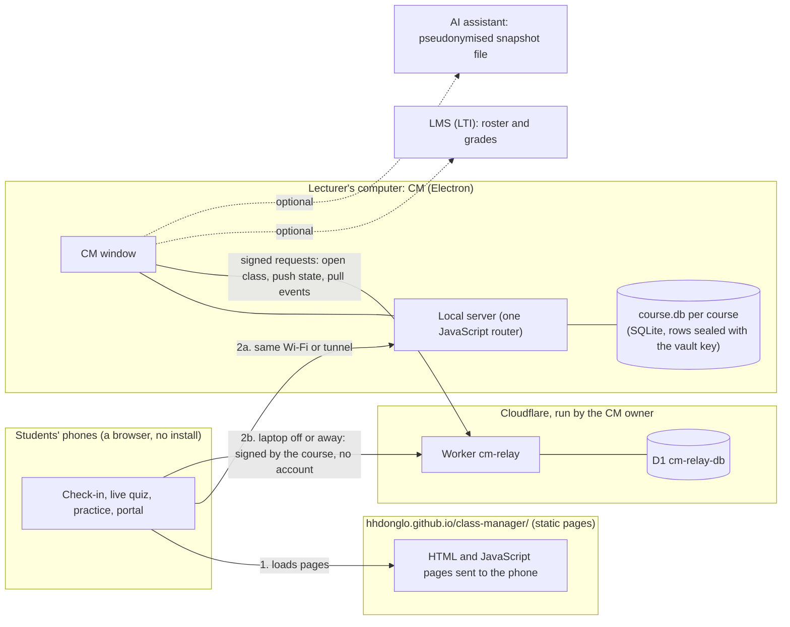
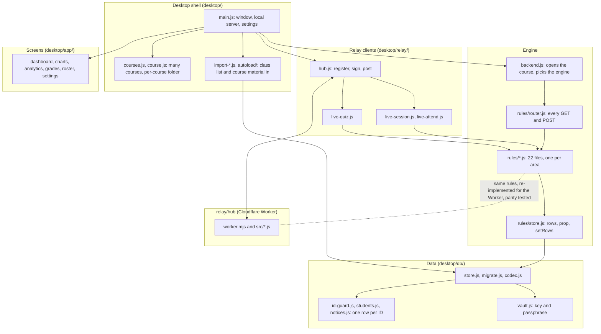
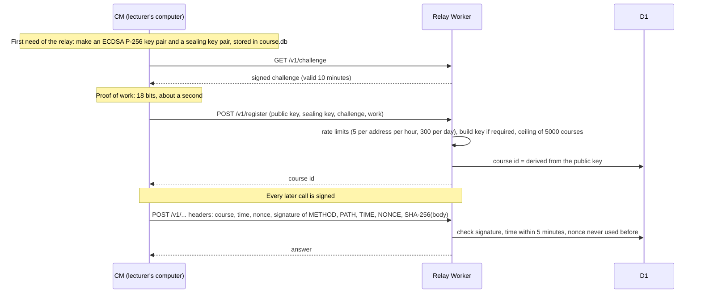
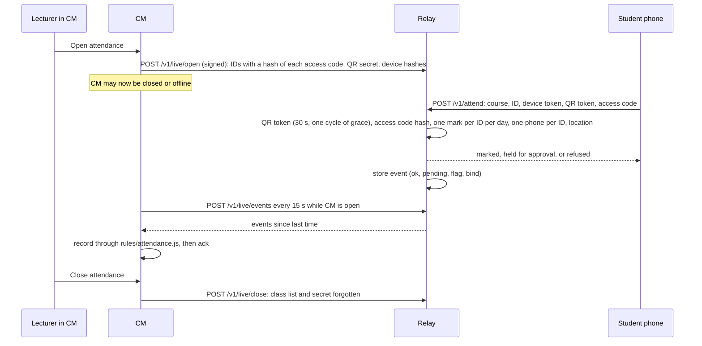
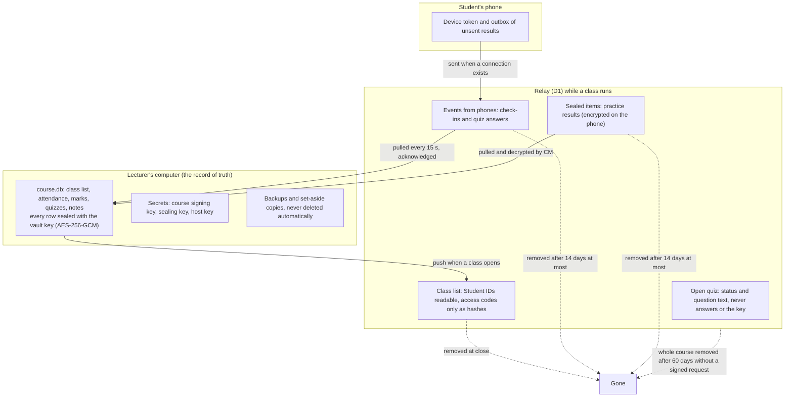
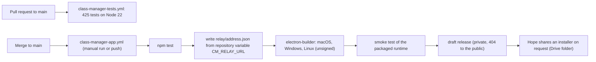

# Class Manager (CM): architecture

Revised 16 November 2026 from `main` at commit `ea2db87` (pull requests #99 to #124 merged). This replaces the text of 9 November, which described the Google Apps Script version. Every statement below was checked against the source or the build logs on that date; where something is a judgement, it says so, and Section 10 and `CM-architecture-review-2026-11-16.md` (in the project files) hold the judgements.

Short version: CM is a desktop program on the lecturer's computer. It keeps one private database per course, runs all the course rules as plain JavaScript, and serves students' phones either directly (same Wi-Fi or tunnel) or through one small hosted relay, so that check-in and live quizzes keep working when the lecturer's computer is off.

## 1. What CM is

- One desktop program (Electron) for a lecturer, one or many courses. Version in `desktop/package.json`: 0.22.2 (the draft release is titled 0.23.0; see Section 9).
- Students use a phone browser. They install nothing and have no account.
- CM's purpose is insight into class dynamics and effective teaching; attendance, QR codes and quizzes are data collection that feeds it.
- Course pages and phone pages are static files on the website (`hhdonglo.github.io/class-manager/`) or served by CM itself; they hold no secrets.



## 2. The three places where code runs

| Place | What runs | Source |
| --- | --- | --- |
| The lecturer's computer | CM window, a local web server, the router, all rules, the course database, the relay clients | `desktop/` |
| The student's phone | Static pages: portal, check-in, live quiz, practice, calendar, messages; an outbox that keeps unsent results | `class-manager/*.html`, `assets/` |
| The relay (Cloudflare Worker plus D1) | Registration, signed requests, live attendance, live quiz, sealed drop box, daily cleanup | `relay/hub/` |

The old mailbox Worker (`relay/worker.mjs`, KV and tokens) is still in the repository and still used when no relay address is built in.

## 3. The engine on the lecturer's computer

```
phone or CM screen
   -> local HTTP server (desktop/main.js, port 8143 by default, listens on all interfaces)
   -> backend.js  (opens the course database, chooses the engine)
   -> rules/router.js  (one `get` and one `post` for every action and kind)
   -> rules/<area>.js  (22 files, 2,869 lines in all: attendance, quiz control and results, scores, class list, learning, statistics, outcomes, groups, assignments, chat, announcements, calendar, progress, auth, access codes, text helpers)
   -> rules/store.js  (rows(tab), setRows(tab, rows), prop, setProp, now)
   -> db/store.js  (SQLite, one file per course)
```

- **Rules are plain JavaScript over a small store interface.** Each file replaces one part of the earlier Apps Script and was parity tested against it (`desktop/test/*-parity.test.js` run the old script and the new module on the same data and compare answers).
- **One router.** Step 7 (#121) made `rules/router.js` answer every request. Step 8 (#122) made it the default engine (`engine` is `js`; `CM_ENGINE=script` still selects the old script for comparison).
- **The old script is still loaded inside CM.** `backend.js` runs `apps_script/quiz_receiver.gs` in a Node sandbox at start-up. It creates the tab layout on a first run and supplies the version string and the location-mode setting that the router reads. It is no longer the engine and nothing is deployed to Google, but it is not yet gone from the program. See Section 10.



## 4. The course database

One SQLite file per course, `courses/<id>/data/course.db`, using the SQLite built into Node 22 (`node:sqlite`). No server, no account, nothing to install.

- Tables: `meta`, `sheet` (the old tabs), `cell_row` (each row as one sealed value), `student` (one row per student), `id_notice`, `receipt`, `prop` (settings and secrets).
- Every row and setting is sealed with the vault key (AES-256-GCM) before it reaches the file (`db/codec.js`, `vault.js`). Anyone who copies `course.db` without the vault key reads nothing.
- Opening is safe: an older `workbook.json` is imported, checked against the source, and only then put in place; the original is renamed, never deleted (`db/migrate.js`).
- **IDs are unique keys.** `ids.js` decides when two IDs are the same (digits only, no ".0", no leading zeros). `db/id-guard.js` merges rows of one ID; `db/students.js` holds a unique key on a keyed fingerprint of the normalised ID, so the database refuses a second row. IDs belong to one course; the key is course plus ID.
- Reset moves the chosen parts of a course into a `reset-<time>` folder and can restore them; it covers attendance as well (`course-reset.js`).
- Layout version: raise `SCHEMA_VERSION` in `db/store.js` when the layout changes. CM must not be downgraded after a newer version has opened a course.

## 5. The relay

One Cloudflare Worker `cm-relay` and one D1 database `cm-relay-db`, run by the CM owner in the owner's account. Lecturers and students never create a Cloudflare account or type an address: the address is written into the installer at build time (Section 9).

**Registration is automatic and has no account.** On first need, CM makes a signing key pair (ECDSA P-256) and a sealing key pair, asks for a challenge, solves a proof of work (18 bits, about a second) and registers. The course id is derived from the public key, so nobody can claim another course. From then on every CM request is signed over method, path, time, a never-repeated nonce and a hash of the body; the relay checks the signature, a clock difference of at most 5 minutes, and that the nonce is new.



**What the relay does**

| Area | Endpoints | What the relay holds | Source |
| --- | --- | --- | --- |
| Registration | `GET /v1/challenge`, `POST /v1/register` | public key, sealing key | `src/registry.js`, `src/limits.js` |
| Phone page data | `GET /v1/course/<id>` | sealing key and small live state, no names | `src/registry.js` |
| Sealed drop box | `POST /v1/drop` (phone), `/v1/pull`, `/v1/ack` (CM) | items encrypted on the phone | `src/mailbox.js` |
| Live attendance | `POST /v1/attend` (phone), `/v1/live/open`, `/events`, `/ack`, `/close` (CM) | class list (Student IDs readable, access codes only as hashes), QR secret, device hashes, events | `src/attend.js` |
| Live quiz | `POST /v1/quiz/call` (phone), `/v1/quiz/put`, `/events`, `/ack`, `/close` (CM) | quiz status and question text (never answers or the key), who joined, answers | `src/quiz.js` |
| Course state and close | `/v1/state`, `/v1/close` | small named values | `src/live.js` |
| Cleanup | scheduled daily | n/a | `src/db.js` |

The Worker is 489 lines in `relay/hub/` (entry `worker.mjs`, one responsibility per file under `src/`).

**Live attendance with the laptop off.** CM sends the class list and the session secret when the lecturer opens attendance; phones check in against the relay, which applies the attendance rules (QR token every 30 seconds with one cycle of grace, access code, one mark per ID per day, one phone per ID per session, one phone per student for the term, location check) and answers at once. CM collects the events every 15 seconds while it is open and records them through `rules/attendance.js`, which stays the authority.



**Live quiz with the laptop off.** CM sends the quiz status and the question text whenever the lecturer acts and every few seconds while it runs. A phone joins and answers on the relay, which admits an answer by the same checks as `rules/quiz-submit.js` (the quiz is running, this is the open question, not closed for more than 15 seconds, the student joined). CM collects the events and records them through the rules. Not on the relay: results with a receipt, ranking and review; they appear when CM is reachable again.

**The rules exist twice.** The relay's attendance and quiz checks are a separate implementation (`relay/hub/src/attend.js`, `quiz.js`) of what `desktop/rules/` does, because the Worker cannot load the CM modules. `relay/hub/test/attend.test.js` runs both on the same cases. This is a drift risk (Section 10).

**Abuse controls with no human step.** New courses: 5 per network address per hour and 300 per day, the proof of work, a ceiling of 5,000 courses, optional `BUILD_KEYS`, and a switch `REGISTRATION_OPEN="0"`. Phones: 120 drops per course per minute and 30 per address, 60 reads per address per minute, a slow-down after wrong access codes. Caps: 16 KB per item, 2,000 items per course, 1,500 students per class list, 6,000 events. Forgetting: unpulled items and events after 14 days, closed sessions after 14 days, an open quiz not refreshed for a day, unused courses (no signed request) after 60 days, nonces and counters daily. `POST /v1/close` deletes everything for a course.

## 6. Where data lives, and for how long



- The lecturer's computer holds the record. The relay holds only what a running class needs, and CM pulls it back.
- While a class runs the relay can read Student IDs and device hashes. Practice results left in the drop box are sealed on the phone and the relay cannot read them.
- Phones keep results in an outbox and send them as soon as a connection exists.
- Optional, off by default: a linked folder or storage provider (`linked-folder.js`, `storage/`, `sync/`) keeps an encrypted copy of a course's records somewhere the lecturer chooses; an LMS connector (`lms/`) reads a roster and sends grades; an assistant export (`llm/`) writes a pseudonymised snapshot file and a read-only MCP server. CM sends nothing to an assistant itself.

## 7. Phones reaching CM

1. **Same network.** Phones open the pages from the local server at the lecturer's address (QR code on the CM home screen).
2. **Internet address.** CM can open a Cloudflare quick tunnel (`tunnel.js`) for a limited number of hours. Lecturer pages are refused through it unless the lecturer turns that on (`access.js`), and the location check is switched on (`attendance-guard.js`).
3. **Relay.** For check-in and live quiz when CM is off or away. CM tells the pages where to go by adding a `relay` field to the answers it gives for `attend_open`, `attend_status` and the quiz control actions.

A relay problem never changes what the lecturer sees from the local server.

## 8. Screens and analytics

`desktop/app/` holds the screens: home, dashboard, Class Analytics (`analytics/`), charts (`charts/`), Grades and Results (`grades/` builds the clean table with per-entry timestamps), roster, import, mailbox, LMS, settings. Each folder has a short README. The analytics are rules-based and show a number and the rule that produced it; they are associations, not causes.

## 9. Build, test, release



- `class-manager-tests.yml` runs `npm test` on every change under `class-manager/`: 425 tests, all passing on 16 November (73 CM test files in `desktop/test/` and the relay tests in `relay/hub/test/`).
- `class-manager-app.yml` builds unsigned installers for macOS, Windows and Linux, runs a smoke test of the packaged runtime on each platform, and creates a draft release. Before building it writes `relay/address.json` from the repository variable `CM_RELAY_URL`. The log of run 225 (main, `ea2db87`) shows `CM_RELAY_URL: https://cm-relay.hkdonglo.workers.dev` for that step, so the address did reach the build. Whether a built installer then reaches the relay from a real computer has not been tested.
- All releases are drafts (`class-manager-releases-private.yml`); download addresses return 404 to the public. Installers are shared on request.
- Relay deployment: `node relay/deploy.mjs` (first time) and `--update` (new code); `--dry-run` shows the plan. It creates short-lived tokens only and never touches other Workers or databases in the account.

## 10. Known limits (summary)

See `CM-architecture-review-2026-11-16.md` for the full list with suggestions.

- Not tested with real phones, a real window click-through, or 200 phones at once.
- Relay session resume after a CM restart is not built: if CM closes mid-class, phones keep checking in but nothing collects the events until the lecturer opens attendance again.
- Receipts and ranking are not on the relay.
- Installers are unsigned; the version string in the files is 0.22.2.
- No privacy notice text yet; Student IDs are readable on the relay while a class runs.
- The Apps Script is still loaded by `backend.js` as a legacy shim.
- The relay's rules are a second implementation, kept in step by tests.

## 11. Where to change things

| To change | Edit | Then |
| --- | --- | --- |
| A course rule | the one file in `desktop/rules/` | add or adjust its parity or unit test; update the file's row in `rules/README.md` |
| A relay rule | the one file in `relay/hub/src/` | run `relay/hub/test`; `node relay/deploy.mjs --update` |
| A table in the database | `SCHEMA` in `db/store.js` | raise `SCHEMA_VERSION`; add a migration test |
| A limit on the relay | `LIMITS` in `src/db.js` or `RATES` in `src/limits.js` | redeploy |
| A screen | `desktop/app/<area>/` | update that folder's README |

## Appendix A. Earlier sections carried forward

The two sections below were written on 9 November 2026 and are not re-verified in this revision. The tabs now live as sealed rows inside `course.db` rather than a workbook file or a Google Sheet; the names and meaning are unchanged.

## 6. Data model: workbook tabs

| Tab | Content | Written by |
|---|---|---|
| Key | Join codes and correct letters; J2 is the lecturer password (a temporary plain key on a new workbook, then `pw1:rounds:salt:hash`; older `sha256:salt:hex` still accepted); the recovery code is a hash in the script property `pw_recovery`; the settings columns K, L and N (week) | `setup`, lecturer |
| Quiz_Control | One row per lecturer-run quiz: status, timers, mode, round, review question, N, question IDs, week | Live quiz |
| Presence, Answers, Staged_Quiz | Who joined; paced answers with confidence; results held until released | Live quiz |
| Form Responses 1 | Released results: name, ID, join code, letters, score, round, questions, answers, week | Release |
| Master, Scores, Totals | One row per student, one column per quiz; the clean grid; totals (Best or Latest) | Rebuilt automatically |
| Log, Reports, Attempts | Submission outcomes; reported problems (emailed in mode A); practice tries with question IDs | POST |
| Explanations | Optional explanation overrides per join code | Lecturer |
| Roster | Student ID and name (the class list) | Class list sync, roster edit |
| Attendance_Control, Attendance_Log, Attendance, Not_On_List, Attendance_Flags | Sessions; held check-ins; the grid; unknown IDs; flags | Attendance |
| Item_Log | One row per student per live quiz question (answer, correct, confidence) | Finalising a quiz |
| Access_Codes | Student ID, personal code (`XXXX-XXXX`, no 0, O, 1, I or L), issued | Lecturer |
| Question_Stats | Per-question proportion correct, discrimination and label | Teaching insights |
| Groups | Set, group, ID, name, group mark, out of, locked, created | Groups |
| Calendar | Event ID, title, kind, start, end (local text `YYYY-MM-DDTHH:MM`), all day, location, agenda, resources, week, linked session, visibility, series, created, updated | Calendar |
| Messages | Message ID, time (ms), conversation, from, name, text, status, removed by | Chat |
| Chat_Groups | Group ID, name, owner, members, created | Chat |
| Chat_Read | Who, conversation, last read (ms); `ANN` holds the last read time of announcements | Chat, announcements |
| Announcements | ID, title, text, audience, pinned, show from, link, event ID, created, updated, status | Lecturer |

**Script properties.** `draw_salt` (per-workbook question draw), and `chat_mode` (on, announce, off), `chat_dm`, `chat_groups`, `chat_rules` and `chat_muted` (a JSON map).

**Conversation IDs.**

- `CLASS`: the whole class.
- `L:<set>|<group>`: a lecturer-made group, taken from the Groups tab.
- `S:<id>`: a group made by students.
- `DM:<studentId>`: a student and the lecturer.
- `P:<idA>:<idB>`: two students, IDs sorted.

**Desktop data folder.** This is `userData`, for example `~/.config/Class Manager` on Linux. It holds:

- `settings.json`;
- `data/course.db` (SQLite, since 0.22.0; all tabs and properties, each row sealed; dates stored as `{$d: ISO}`), encrypted per row (AES-256-GCM, magic `CMV1`) with the data key `data.key`, which is itself encrypted with the system keychain (`safeStorage`) where available (`desktop/vault.js`);
- `courses/<id>/backups/` (automatic encrypted backups of the workbook: on opening the course, every four hours and on closing; each read back and checked; the newest 14 kept, plus copies made before a restore);
- `anthropic.bin` (the API key), encrypted with `safeStorage` where available;
- `authoring/library/` (copies of documents, `<id>.chunks.json`, `index.json`);
- `authoring/drafts.json` and `authoring/settings.json` (the model);
- `authoring/banks/lectureN.json` (approved questions, with a `next` counter).


## 9. Resources, retrieval and the language model (desktop only)

```
 add file --> extract text            --> chunk (~900 chars, per page or slide) --> library/<id>.chunks.json
              PDF: unpdf (pdf.js), lines rebuilt from text positions
              DOCX: mammoth raw text; PPTX: jszip, <a:t> runs per slide; MD/TXT: as is
 search   --> BM25 over all passages (k1 = 1.4, b = 0.75), terms = lower-case words, stop words removed, plural s stripped
 summary  --> with key: Claude, whole document (map-reduce above 600,000 characters, parts of 400,000)
              without key: extractive (sentences scored by tf-idf, 5 to 14 kept in order, plus 14 key terms)
 generate --> passages: whole documents if no focus and under 300,000 characters; else BM25 top passages up to 300,000
              + plain stems of the lecture's existing questions (to avoid repeats)
              --> Claude (JSON schema: quizzes[].questions[] with type, difficulty, q, options, answer, exp, ref)
              --> options shuffled, text sanitised to HTML --> drafts.json (status draft, batch, set, source documents)
 import   --> same extraction --> template parser --> validation --> preview --> drafts
 approve  --> validation (4 distinct options, valid answer, lecture) --> banks/lectureN.json, ID L{n}-U{nn}
              server merges course bank + overlay for /quizzes/lectureN.json and live_quizzes.json weeks;
              the script's 5-minute bank cache is cleared
```

**Model call** (`askJson` in `authoring.js`). The call is made with the official SDK, `@anthropic-ai/sdk` 1.6.0:

- `messages.stream(...).finalMessage()`;
- model from Settings (default `claude-opus-5-5`);
- `thinking: {type: "adaptive"}` and `output_config: {effort: "high", format: {type: "json_schema", schema}}`;
- for the models that accept it, the beta `server-side-fallback-2026-07-01` with `fallbacks: "default"`;
- `max_tokens` of 16,000 for summaries, and up to 64,000 for generation.

Error types (authentication, permission, not found, rate limit, connection) become plain messages. A `refusal` or `max_tokens` stop is reported, and nothing is saved.

**Validation rules** (shared by import, editing and approval):

- the question has text;
- exactly four options, none empty, no two the same;
- the answer index is valid;
- the lecture is set.

Two warnings do not block approval: a missing explanation or difficulty, and a duplicate of a bank question or another draft.

**Text safety.** All imported and generated text is escaped. Only `<sub>`, `<sup>`, `<em>`, `<strong>`, `<b>`, `<i>` and `<br>` are re-allowed, and `^` and `_` notation becomes `<sup>` and `<sub>`.

